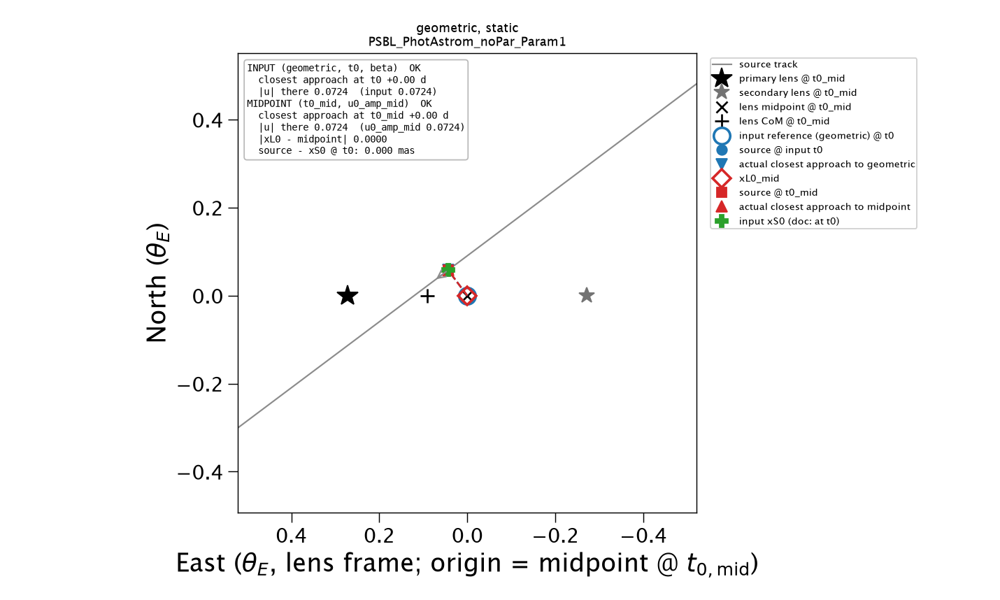
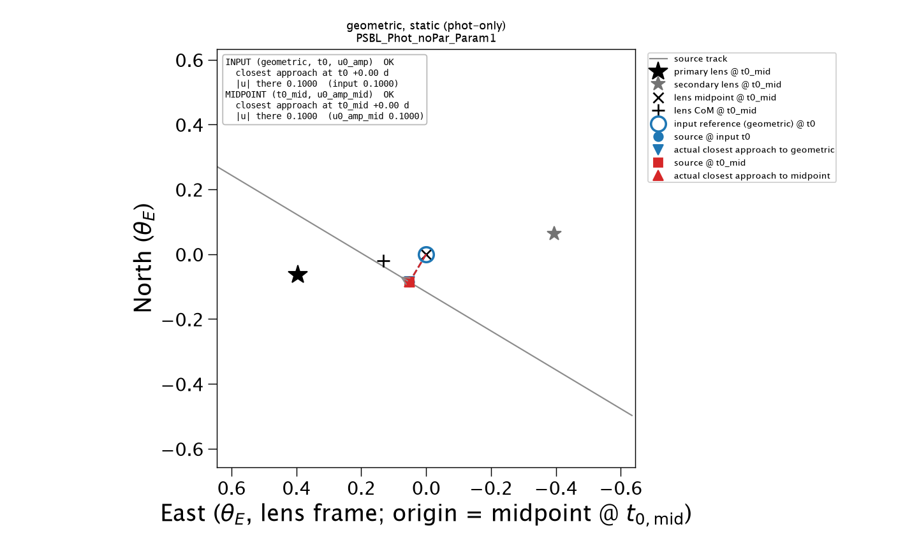
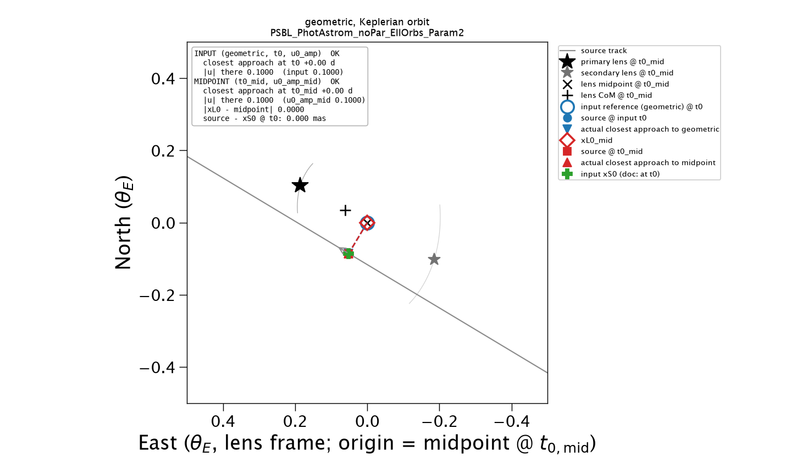
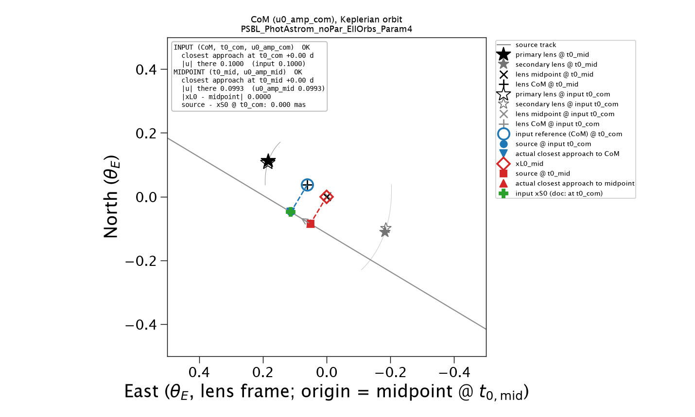
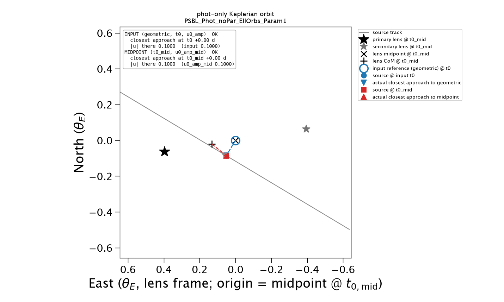

# Binary-lens reference-frame audit

**Convention under test.** Every binary class stores three frames, named by
suffix: `_com` (source CoM to lens CoM), `_p` (primary source to primary
lens) and `_mid` (primary source to the lens **geometric midpoint**).
Inputs may be given in any of them and must be honored in that frame,
including the input `xS0` (`xS0_E` / `xS0_com_E` / `xS0_p_E`) at the input
`t0*`. The internal `self.t0` / `u0_amp` / `xL0` are the midpoint pair for
static, linear and accelerated classes, and the CoM pair for Keplerian
classes (except the midpoint-input Param2 / Param3). For orbiting binaries
the midpoint and primaries move, so their `(t0, u0)` are defined at an
instant: at `t0` the source point is `u0` from the lens point's position
*at that time*, perpendicular to the relative proper motion. Those pairs
are root-solved lazily (`t0_mid`, `u0_amp_mid`, `xL0_mid`, `t0_p`, ...).
The CoMs move on straight lines, so the CoM pair is an exact closest
approach. Orbits are always evaluated about the CoMs.

**Result.** All PSBL / FSBL and BSBL / BFSBL parameterizations, static and
Keplerian (including phot-only), honor their input frame and fill the
midpoint frame consistently. The remaining failures are the primary-input
linear / accelerated orbit classes (see Remaining issues).

## Method

`make_binary_frame_audit.py` (this directory) builds one model per binary-
lens Param class in `bagle.model_jax` (PSBL, FSBL, BSBL, BFSBL; FSBL/BFSBL
exist only there), with parallax switched off so tracks are straight. For
each reference point it measures where the source point passes (the
source CoM for binary-source `_com` inputs, else the primary source):

* the **input reference point** (midpoint, CoM = mass-weighted, or primary)
  — the time should equal the input `t0*` and the separation the input
  `u0*` / `beta* / thetaE`;
* the **actual lens midpoint** — the time should equal `t0_mid`, the
  separation `|u0_amp_mid|`, and `xL0_mid` should be the midpoint at
  `t0_mid` (for static / linear classes these alias the internal `t0`,
  `u0_amp`, `xL0`);
* the input **`xS0`** at the time named in the docstring.

Static points and the CoM use the true closest approach on a fine time grid.
Moving points (midpoint or primary of an orbiting binary) use the
instantaneous definition at the reference time: the along-track offset is
reported as a time shift and the cross-track distance as the separation.

Figures are in Einstein radii, in the frame co-moving with the lens CoM
(so the source track is the relative-motion line, static lenses stay fixed,
and orbiting lenses trace their orbits), centered on the lens midpoint at
the internal `t0`, with East to the left. Blue marks the input frame (open circle: input
reference point at the input time; filled circle: source then; ▼: actual
closest approach to that point). Red marks the internal frame (◇: internal
`xL0`; ■: source at internal `t0`; ▲: actual closest approach to the lens
midpoint). Stars are the lenses (filled at internal `t0`, open at the input
time when the lenses moved); × is the midpoint and + the CoM. Green ✚ is
the input `xS0`. A ✅ needs both markers of a color to coincide. For
orbiting lenses the ▼ / ▲ markers are the linear closest approach, so they
need not coincide with the instantaneous definition.

## Representative cases

| # | Case | Class | Input frame | Input honored | Midpoint frame |
|---|---|---|---|---|---|
| 1 | geometric, static | `PSBL_PhotAstrom_noPar_Param1` | geometric (`t0`, `beta`) | ✅ | ✅ |
| 2 | geometric, static (phot-only) | `PSBL_Phot_noPar_Param1` | geometric (`t0`, `u0_amp`) | ✅ | ✅ |
| 3 | geometric, static (binary source) | `BSBL_PhotAstrom_noPar_Param1` | geometric (`t0`, `beta`) | ✅ | ✅ |
| 4 | CoM, static | `PSBL_PhotAstrom_noPar_Param4` | CoM (`t0_com`, `u0_amp_com`) | ✅ | ✅ |
| 5 | primary (t0_prim), static | `PSBL_PhotAstrom_Par_Param5` | primary (`t0_prim`, `u0_amp_prim`) | ✅ | ✅ |
| 6 | primary (t0_p), static | `PSBL_PhotAstrom_Par_Param7` | primary (`t0_p`, `beta_p`) | ✅ | ✅ |
| 7 | geometric, Keplerian orbit | `PSBL_PhotAstrom_noPar_EllOrbs_Param2` | geometric (`t0`, `u0_amp`) | ✅ | ✅ |
| 8 | CoM (beta_com), Keplerian orbit | `PSBL_PhotAstrom_noPar_EllOrbs_Param1` | CoM (`t0_com`, `beta_com`) | ✅ | ✅ |
| 9 | CoM (u0_amp_com), Keplerian orbit | `PSBL_PhotAstrom_noPar_EllOrbs_Param4` | CoM (`t0_com`, `u0_amp_com`) | ✅ | ✅ |
| 10 | primary, Keplerian orbit | `PSBL_PhotAstrom_noPar_EllOrbs_Param7` | primary (`t0_p`, `beta_p`) | ✅ | ✅ |
| 11 | phot-only Keplerian orbit | `PSBL_Phot_noPar_EllOrbs_Param1` | geometric (`t0`, `u0_amp`) | ✅ | ✅ |
| 12 | binary source, Keplerian orbit | `BSBL_PhotAstrom_noPar_EllOrbs_Param1` | CoM (`t0_com`, `beta_com`) | ✅ | ✅ |

### 1. geometric, static: `PSBL_PhotAstrom_noPar_Param1`

Geometric inputs (`t0`, `beta`), static lenses. Input and internal frames are the same and exact.



### 2. geometric, static (phot-only): `PSBL_Phot_noPar_Param1`

Phot-only (Einstein radii), geometric inputs. Exact.



### 3. geometric, static (binary source): `BSBL_PhotAstrom_noPar_Param1`

Binary source, geometric lens inputs, measured with the primary source. Exact.


### 4. CoM, static: `PSBL_PhotAstrom_noPar_Param4`

CoM inputs (`t0_com`, `u0_amp_com`), converted with `convert_u0_amp_t0_psbl`. Both frames exact (the old sin φ sign error is fixed).


### 5. primary (t0_prim), static: `PSBL_PhotAstrom_Par_Param5`

Primary inputs (`t0_prim`, `u0_amp_prim`). Both frames exact.


### 6. primary (t0_p), static: `PSBL_PhotAstrom_Par_Param7`

Primary inputs (`t0_p`, `beta_p`) via the rewritten `fc.convert_u0_t0_psbl`. Both frames exact.


### 7. geometric, Keplerian orbit: `PSBL_PhotAstrom_noPar_EllOrbs_Param2`

Geometric inputs with a Keplerian orbit. The CoM closest approach comes from the orbit at `t0` (`convert_u0_amp_t0_psbl_orbit`), so `xL0` is the midpoint at `t0` and the inputs hold at that instant.



### 8. CoM (beta_com), Keplerian orbit: `PSBL_PhotAstrom_noPar_EllOrbs_Param1`

CoM inputs (`t0_com`, `beta_com`, `xS0_com_E/N`) with a Keplerian orbit. The CoM pair is the internal frame; `t0_mid` solves (lazily) for the instant when the source - midpoint vector is perpendicular to the motion.


### 9. CoM (u0_amp_com), Keplerian orbit: `PSBL_PhotAstrom_noPar_EllOrbs_Param4`

CoM inputs (`t0_com`, `u0_amp_com`, `xS0_com_E/N`) with a Keplerian orbit. CoM pair internal; midpoint pair lazy and exact.



### 10. primary, Keplerian orbit: `PSBL_PhotAstrom_noPar_EllOrbs_Param7`

Primary inputs (`t0_p`, `beta_p`, `xS0_p_E/N`) with a Keplerian orbit: primary at `t0_p` → CoM (explicit, internal) → midpoint (lazy). Both frames exact.


### 11. phot-only Keplerian orbit: `PSBL_Phot_noPar_EllOrbs_Param1`

Phot-only Keplerian orbit. `t0` / `u0_amp` are geometric at `t0`; the source track (`get_complex_pos`, `get_u`) runs from the CoM closest approach `t0_com` / `u0_com`, since the lenses orbit the CoM.



### 12. binary source, Keplerian orbit: `BSBL_PhotAstrom_noPar_EllOrbs_Param1`

Binary source and binary lens, both orbiting. CoM-CoM inputs (`t0_com`, `beta_com`, `xS0_com_E/N`), measured with the source CoM; the CoM pair is internal and the midpoint pair (primary source to lens midpoint) is lazy. Both frames exact. Converted with `convert_u0_amp_t0_bsbl_orbit`.


## Every binary-lens parameterization

Times in days, separations in Einstein radii, `xS0` offset in mas. `Δt_in` / `|u|_in`: closest approach to the input reference point relative to the input time, and the separation there (compare with `input |u|`). `Δt_geo` / `|u|_geo`: closest approach to the actual lens midpoint relative to the internal `t0`, and the separation there (compare with `u0_amp`). `xL0`: distance from the internal `xL0` to the actual midpoint at `t0`. `xS0`: source distance from the input `xS0` at its documented time.

| Param class | Input | Δt_in | \|u\|_in | input \|u\| | Δt_geo | \|u\|_geo | u0_amp | xL0 | xS0 (time) | In | Int |
|---|---|---|---|---|---|---|---|---|---|---|---|
| `BFSBL_PhotAstromParam1` | geometric `t0` | +0.00 | 0.0724 | 0.0724 | +0.00 | 0.0724 | 0.0724 | 0.0000 | 0.000 (t0) | ✅ | ✅ |
| `BFSBL_PhotAstromParam2` | primary `t0_p` | +0.00 | 0.0724 | 0.0724 | +0.00 | 0.2352 | 0.2352 | 0.0000 | 0.000 (t0_p) | ✅ | ✅ |
| `BFSBL_PhotAstrom_AccOrbs_Param1` | geometric `t0` | +0.00 | 0.0724 | 0.0724 | +0.00 | 0.0724 | 0.0724 | 0.0000 | 0.000 (t0) | ✅ | ✅ |
| `BFSBL_PhotAstrom_CircOrbs_Param1` | CoM `t0_com` | +0.00 | 0.0724 | 0.0724 | +0.00 | 0.1246 | 0.1246 | 0.0000 | 0.000 (t0_com) | ✅ | ✅ |
| `BFSBL_PhotAstrom_CircOrbs_Param2` | CoM `t0_com` | +0.00 | 0.1000 | 0.1000 | +0.00 | 0.1181 | 0.1181 | 0.0000 | 0.000 (t0_com) | ✅ | ✅ |
| `BFSBL_PhotAstrom_CircOrbs_Param3` | primary `t0_p` | +0.00 | 0.0724 | 0.0724 | +0.00 | 0.3136 | 0.3136 | 0.0000 | 0.000 (t0_p) | ✅ | ✅ |
| `BFSBL_PhotAstrom_EllOrbs_Param1` | CoM `t0_com` | +0.00 | 0.0724 | 0.0724 | +0.00 | 0.1002 | 0.1002 | 0.0000 | 0.000 (t0_com) | ✅ | ✅ |
| `BFSBL_PhotAstrom_EllOrbs_Param2` | CoM `t0_com` | +0.00 | 0.1000 | 0.1000 | +0.00 | 0.1224 | 0.1224 | 0.0000 | 0.000 (t0_com) | ✅ | ✅ |
| `BFSBL_PhotAstrom_EllOrbs_Param3` | primary `t0_p` | +0.00 | 0.0724 | 0.0724 | +0.00 | 0.2577 | 0.2577 | 0.0000 | 0.000 (t0_p) | ✅ | ✅ |
| `BFSBL_PhotAstrom_LinOrbs_Param1` | geometric `t0` | +0.00 | 0.0724 | 0.0724 | +0.00 | 0.0724 | 0.0724 | 0.0000 | 0.000 (t0) | ✅ | ✅ |
| `BFSBL_PhotParam1` | geometric `t0` | +0.00 | 0.1000 | 0.1000 | +0.00 | 0.1000 | 0.1000 | – | – | ✅ | ✅ |
| `BSBL_PhotAstromParam1` | geometric `t0` | +0.00 | 0.0724 | 0.0724 | +0.00 | 0.0724 | 0.0724 | 0.0000 | 0.000 (t0) | ✅ | ✅ |
| `BSBL_PhotAstromParam2` | primary `t0_p` | +0.00 | 0.0724 | 0.0724 | +0.00 | 0.2352 | 0.2352 | 0.0000 | 0.000 (t0_p) | ✅ | ✅ |
| `BSBL_PhotAstrom_AccOrbs_Param1` | geometric `t0` | +0.00 | 0.0724 | 0.0724 | +0.00 | 0.0724 | 0.0724 | 0.0000 | 0.000 (t0) | ✅ | ✅ |
| `BSBL_PhotAstrom_CircOrbs_Param1` | CoM `t0_com` | +0.00 | 0.0724 | 0.0724 | +0.00 | 0.1246 | 0.1246 | 0.0000 | 0.000 (t0_com) | ✅ | ✅ |
| `BSBL_PhotAstrom_CircOrbs_Param2` | CoM `t0_com` | +0.00 | 0.1000 | 0.1000 | +0.00 | 0.1181 | 0.1181 | 0.0000 | 0.000 (t0_com) | ✅ | ✅ |
| `BSBL_PhotAstrom_CircOrbs_Param3` | primary `t0_p` | +0.00 | 0.0724 | 0.0724 | +0.00 | 0.3136 | 0.3136 | 0.0000 | 0.000 (t0_p) | ✅ | ✅ |
| `BSBL_PhotAstrom_EllOrbs_Param1` | CoM `t0_com` | +0.00 | 0.0724 | 0.0724 | +0.00 | 0.1002 | 0.1002 | 0.0000 | 0.000 (t0_com) | ✅ | ✅ |
| `BSBL_PhotAstrom_EllOrbs_Param2` | CoM `t0_com` | +0.00 | 0.1000 | 0.1000 | +0.00 | 0.1224 | 0.1224 | 0.0000 | 0.000 (t0_com) | ✅ | ✅ |
| `BSBL_PhotAstrom_EllOrbs_Param3` | primary `t0_p` | +0.00 | 0.0724 | 0.0724 | +0.00 | 0.2577 | 0.2577 | 0.0000 | 0.000 (t0_p) | ✅ | ✅ |
| `BSBL_PhotAstrom_LinOrbs_Param1` | geometric `t0` | +0.00 | 0.0724 | 0.0724 | +0.00 | 0.0724 | 0.0724 | 0.0000 | 0.000 (t0) | ✅ | ✅ |
| `BSBL_PhotParam1` | geometric `t0` | +0.00 | 0.1000 | 0.1000 | +0.00 | 0.1000 | 0.1000 | – | – | ✅ | ✅ |
| `FSBL_PhotAstromParam1` | geometric `t0` | +0.00 | 0.0724 | 0.0724 | +0.00 | 0.0724 | 0.0724 | 0.0000 | 0.000 (t0) | ✅ | ✅ |
| `FSBL_PhotAstromParam2` | geometric `t0` | +0.00 | 0.1000 | 0.1000 | +0.00 | 0.1000 | 0.1000 | 0.0000 | 0.000 (t0) | ✅ | ✅ |
| `FSBL_PhotAstromParam3` | geometric `t0` | +0.00 | 0.1000 | 0.1000 | +0.00 | 0.1000 | 0.1000 | 0.0000 | 0.000 (t0) | ✅ | ✅ |
| `FSBL_PhotAstromParam4` | CoM `t0_com` | +0.00 | 0.1000 | 0.1000 | +0.00 | 0.1514 | 0.1514 | 0.0000 | 0.000 (t0) | ✅ | ✅ |
| `FSBL_PhotAstromParam5` | primary `t0_prim` | +0.00 | 0.1000 | 0.1000 | +0.00 | 0.2543 | 0.2543 | 0.0000 | 0.000 (t0) | ✅ | ✅ |
| `FSBL_PhotAstromParam6` | primary `t0_prim` | +0.00 | 0.1000 | 0.1000 | +0.00 | 0.2543 | 0.2543 | 0.0000 | 0.000 (t0) | ✅ | ✅ |
| `FSBL_PhotAstromParam7` | primary `t0_p` | +0.00 | 0.0724 | 0.0724 | +0.00 | 0.2352 | 0.2352 | 0.0000 | 0.000 (t0) | ✅ | ✅ |
| `FSBL_PhotAstromParam8` | CoM `t0_com` | +0.00 | 0.1000 | 0.1000 | +0.00 | 0.1514 | 0.1514 | 0.0000 | 0.000 (t0) | ✅ | ✅ |
| `FSBL_PhotAstrom_AccOrbs_Param1` | geometric `t0` | +0.00 | 0.0724 | 0.0724 | +0.00 | 0.0724 | 0.0724 | 0.0000 | 0.000 (t0) | ✅ | ✅ |
| `FSBL_PhotAstrom_AccOrbs_Param3` | geometric `t0` | +0.00 | 0.1000 | 0.1000 | +0.00 | 0.1000 | 0.1000 | 0.0000 | 0.000 (t0) | ✅ | ✅ |
| `FSBL_PhotAstrom_AccOrbs_Param6` | primary `t0_prim` | -51.45 | 0.4087 | 0.1000 | +0.00 | 0.2543 | 0.2543 | 0.0000 | 0.000 (t0) | ❌ | ✅ |
| `FSBL_PhotAstrom_AccOrbs_Param7` | primary `t0_p` | -175.32 | 0.3981 | 0.0724 | +0.00 | 0.2352 | 0.2352 | 0.0000 | 0.000 (t0) | ❌ | ✅ |
| `FSBL_PhotAstrom_CircOrbs_Param1` | CoM `t0_com` | +0.00 | 0.0724 | 0.0724 | +0.00 | 0.1512 | 0.1512 | 0.0000 | 0.000 (t0_com) | ✅ | ✅ |
| `FSBL_PhotAstrom_CircOrbs_Param3` | geometric `t0` | +0.00 | 0.1000 | 0.1000 | +0.00 | 0.1000 | 0.1000 | 0.0000 | 0.000 (t0) | ✅ | ✅ |
| `FSBL_PhotAstrom_CircOrbs_Param4` | CoM `t0_com` | +0.00 | 0.1000 | 0.1000 | +0.00 | 0.0901 | 0.0901 | 0.0000 | 0.000 (t0_com) | ✅ | ✅ |
| `FSBL_PhotAstrom_CircOrbs_Param7` | primary `t0_p` | +0.00 | 0.0724 | 0.0724 | +0.00 | 0.3085 | 0.3085 | 0.0000 | 0.000 (t0_p) | ✅ | ✅ |
| `FSBL_PhotAstrom_CircOrbs_Param8` | CoM `t0_com` | +0.00 | 0.1000 | 0.1000 | +0.00 | 0.0901 | 0.0901 | 0.0000 | 0.000 (t0_com) | ✅ | ✅ |
| `FSBL_PhotAstrom_EllOrbs_Param1` | CoM `t0_com` | +0.00 | 0.0724 | 0.0724 | +0.00 | 0.1325 | 0.1325 | 0.0000 | 0.000 (t0_com) | ✅ | ✅ |
| `FSBL_PhotAstrom_EllOrbs_Param3` | geometric `t0` | +0.00 | 0.1000 | 0.1000 | +0.00 | 0.1000 | 0.1000 | 0.0000 | 0.000 (t0) | ✅ | ✅ |
| `FSBL_PhotAstrom_EllOrbs_Param4` | CoM `t0_com` | +0.00 | 0.1000 | 0.1000 | +0.00 | 0.0993 | 0.0993 | 0.0000 | 0.000 (t0_com) | ✅ | ✅ |
| `FSBL_PhotAstrom_EllOrbs_Param7` | primary `t0_p` | +0.00 | 0.0724 | 0.0724 | +0.00 | 0.2519 | 0.2519 | 0.0000 | 0.000 (t0_p) | ✅ | ✅ |
| `FSBL_PhotAstrom_EllOrbs_Param8` | CoM `t0_com` | +0.00 | 0.1000 | 0.1000 | +0.00 | 0.0993 | 0.0993 | 0.0000 | 0.000 (t0_com) | ✅ | ✅ |
| `FSBL_PhotAstrom_LinOrbs_Param1` | geometric `t0` | +0.00 | 0.0724 | 0.0724 | +0.00 | 0.0724 | 0.0724 | 0.0000 | 0.000 (t0) | ✅ | ✅ |
| `FSBL_PhotAstrom_LinOrbs_Param3` | geometric `t0` | +0.00 | 0.1000 | 0.1000 | +0.00 | 0.1000 | 0.1000 | 0.0000 | 0.000 (t0) | ✅ | ✅ |
| `FSBL_PhotAstrom_LinOrbs_Param6` | primary `t0_prim` | -51.45 | 0.4087 | 0.1000 | +0.00 | 0.2543 | 0.2543 | 0.0000 | 0.000 (t0) | ❌ | ✅ |
| `FSBL_PhotAstrom_LinOrbs_Param7` | primary `t0_p` | -175.32 | 0.3981 | 0.0724 | +0.00 | 0.2352 | 0.2352 | 0.0000 | 0.000 (t0) | ❌ | ✅ |
| `FSBL_PhotParam1` | geometric `t0` | +0.00 | 0.1000 | 0.1000 | +0.00 | 0.1000 | 0.1000 | – | – | ✅ | ✅ |
| `FSBL_Phot_CircOrbs_Param1` | geometric `t0` | +0.00 | 0.1000 | 0.1000 | +0.00 | 0.1000 | 0.1000 | – | – | ✅ | ✅ |
| `FSBL_Phot_EllOrbs_Param1` | geometric `t0` | +0.00 | 0.1000 | 0.1000 | +0.00 | 0.1000 | 0.1000 | – | – | ✅ | ✅ |
| `PSBL_PhotAstromParam1` | geometric `t0` | +0.00 | 0.0724 | 0.0724 | +0.00 | 0.0724 | 0.0724 | 0.0000 | 0.000 (t0) | ✅ | ✅ |
| `PSBL_PhotAstromParam2` | geometric `t0` | +0.00 | 0.1000 | 0.1000 | +0.00 | 0.1000 | 0.1000 | 0.0000 | 0.000 (t0) | ✅ | ✅ |
| `PSBL_PhotAstromParam3` | geometric `t0` | +0.00 | 0.1000 | 0.1000 | +0.00 | 0.1000 | 0.1000 | 0.0000 | 0.000 (t0) | ✅ | ✅ |
| `PSBL_PhotAstromParam4` | CoM `t0_com` | +0.00 | 0.1000 | 0.1000 | +0.00 | 0.1514 | 0.1514 | 0.0000 | 0.000 (t0) | ✅ | ✅ |
| `PSBL_PhotAstromParam5` | primary `t0_prim` | +0.00 | 0.1000 | 0.1000 | +0.00 | 0.2543 | 0.2543 | 0.0000 | 0.000 (t0) | ✅ | ✅ |
| `PSBL_PhotAstromParam7` | primary `t0_p` | +0.00 | 0.0724 | 0.0724 | +0.00 | 0.2352 | 0.2352 | 0.0000 | 0.000 (t0) | ✅ | ✅ |
| `PSBL_PhotAstrom_AccOrbs_Param1` | geometric `t0` | +0.00 | 0.0724 | 0.0724 | +0.00 | 0.0724 | 0.0724 | 0.0000 | 0.000 (t0) | ✅ | ✅ |
| `PSBL_PhotAstrom_AccOrbs_Param6` | primary `t0_prim` | -51.45 | 0.4087 | 0.1000 | +0.00 | 0.2543 | 0.2543 | 0.0000 | 0.000 (t0) | ❌ | ✅ |
| `PSBL_PhotAstrom_AccOrbs_Param7` | primary `t0_p` | -175.32 | 0.3981 | 0.0724 | +0.00 | 0.2352 | 0.2352 | 0.0000 | 0.000 (t0) | ❌ | ✅ |
| `PSBL_PhotAstrom_CircOrbs_Param1` | CoM `t0_com` | +0.00 | 0.0724 | 0.0724 | +0.00 | 0.1512 | 0.1512 | 0.0000 | 0.000 (t0_com) | ✅ | ✅ |
| `PSBL_PhotAstrom_CircOrbs_Param2` | geometric `t0` | +0.00 | 0.1000 | 0.1000 | +0.00 | 0.1000 | 0.1000 | 0.0000 | 0.000 (t0) | ✅ | ✅ |
| `PSBL_PhotAstrom_CircOrbs_Param3` | geometric `t0` | +0.00 | 0.1000 | 0.1000 | +0.00 | 0.1000 | 0.1000 | 0.0000 | 0.000 (t0) | ✅ | ✅ |
| `PSBL_PhotAstrom_CircOrbs_Param4` | CoM `t0_com` | +0.00 | 0.1000 | 0.1000 | +0.00 | 0.0901 | 0.0901 | 0.0000 | 0.000 (t0_com) | ✅ | ✅ |
| `PSBL_PhotAstrom_CircOrbs_Param7` | primary `t0_p` | +0.00 | 0.0724 | 0.0724 | +0.00 | 0.3085 | 0.3085 | 0.0000 | 0.000 (t0_p) | ✅ | ✅ |
| `PSBL_PhotAstrom_CircOrbs_Param8` | CoM `t0_com` | +0.00 | 0.1000 | 0.1000 | +0.00 | 0.0901 | 0.0901 | 0.0000 | 0.000 (t0_com) | ✅ | ✅ |
| `PSBL_PhotAstrom_EllOrbs_Param1` | CoM `t0_com` | +0.00 | 0.0724 | 0.0724 | +0.00 | 0.1325 | 0.1325 | 0.0000 | 0.000 (t0_com) | ✅ | ✅ |
| `PSBL_PhotAstrom_EllOrbs_Param2` | geometric `t0` | +0.00 | 0.1000 | 0.1000 | +0.00 | 0.1000 | 0.1000 | 0.0000 | 0.000 (t0) | ✅ | ✅ |
| `PSBL_PhotAstrom_EllOrbs_Param3` | geometric `t0` | +0.00 | 0.1000 | 0.1000 | +0.00 | 0.1000 | 0.1000 | 0.0000 | 0.000 (t0) | ✅ | ✅ |
| `PSBL_PhotAstrom_EllOrbs_Param4` | CoM `t0_com` | +0.00 | 0.1000 | 0.1000 | +0.00 | 0.0993 | 0.0993 | 0.0000 | 0.000 (t0_com) | ✅ | ✅ |
| `PSBL_PhotAstrom_EllOrbs_Param7` | primary `t0_p` | +0.00 | 0.0724 | 0.0724 | +0.00 | 0.2519 | 0.2519 | 0.0000 | 0.000 (t0_p) | ✅ | ✅ |
| `PSBL_PhotAstrom_EllOrbs_Param8` | CoM `t0_com` | +0.00 | 0.1000 | 0.1000 | +0.00 | 0.0993 | 0.0993 | 0.0000 | 0.000 (t0_com) | ✅ | ✅ |
| `PSBL_PhotAstrom_LinOrbs_Param1` | geometric `t0` | +0.00 | 0.0724 | 0.0724 | +0.00 | 0.0724 | 0.0724 | 0.0000 | 0.000 (t0) | ✅ | ✅ |
| `PSBL_PhotAstrom_LinOrbs_Param6` | primary `t0_prim` | -51.45 | 0.4087 | 0.1000 | +0.00 | 0.2543 | 0.2543 | 0.0000 | 0.000 (t0) | ❌ | ✅ |
| `PSBL_PhotAstrom_LinOrbs_Param7` | primary `t0_p` | -175.32 | 0.3981 | 0.0724 | +0.00 | 0.2352 | 0.2352 | 0.0000 | 0.000 (t0) | ❌ | ✅ |
| `PSBL_PhotParam1` | geometric `t0` | +0.00 | 0.1000 | 0.1000 | +0.00 | 0.1000 | 0.1000 | – | – | ✅ | ✅ |
| `PSBL_Phot_CircOrbs_Param1` | geometric `t0` | +0.00 | 0.1000 | 0.1000 | +0.00 | 0.1000 | 0.1000 | – | – | ✅ | ✅ |
| `PSBL_Phot_EllOrbs_Param1` | geometric `t0` | +0.00 | 0.1000 | 0.1000 | +0.00 | 0.1000 | 0.1000 | – | – | ✅ | ✅ |

## Fixes applied

1. **Static CoM / primary ↔ geometric shift.** The old scalar formula
   `u0_amp = u0_amp_com ∓ ½·qeff·sep·sin φ/θE` used one sign, but the sign
   of the shift depends on which side of the motion the positive-`u0_amp`
   direction lies, so it was right for southward motion only. The shift is
   now done on the closest-approach vector
   (`bagle.model.convert_u0_amp_t0_psbl`; JAX:
   `derive_psbl_param4_heliocentric`). Used by Param4/5/6/8.
2. **`fc.convert_u0_t0_psbl` rewritten** from the binary-axis geometry
   (it shifted u0 by component signs, and most `t0` branches had the wrong
   sign). Param7 also keeps the sign of `u0_amp`.
3. **Keplerian orbits** convert frames with the orbit at the reference
   time (`convert_u0_amp_t0_psbl_orbit`) instead of a snapshot at `tp` with
   separation `a`; `alpha` / `phi` / `sep_t0` are reported at `t0`. The
   traced PSTL EllOrbs Param2 path uses the same definition.
4. **Phot-only orbits** store `t0_com` / `u0_com` and run the source track
   about the CoM in `get_complex_pos` and `get_u`; `phi_rho1_rad` is now in
   radians.
5. **EllOrbs / CircOrbs Param1** list `beta_com` (not `beta`) in
   `fitter_param_names`.
6. **`xS0` is always at the input reference time** (`t0_com`, `t0` or
   `t0_p`); EllOrbs / CircOrbs Param3 and Param7 now follow Param1/2/4/8.
7. **Phot-only orbit constructors** take their arguments in
   `fitter_param_names` order (`t0, u0_amp, tE, piE_E, piE_N, q, sep,
   v_para, v_perp, v_rad, r_s, a_s, b_sff, mag_src`; FSBL adds `radiusS`),
   and derive `aleph` / `aleph_sec` from `sep`, `r_s`, `a_s` and `q`.
8. **Phot-only orbit elements** come from `bagle.orbits.relative_state_to_elements`,
   written in the `Orbit.oal2xy` (Thiele-Innes) frame, so the orbit
   reproduces `sep`, the axis angle, `r_s` and the velocities at `t0`
   (circular orbits included). A new `phi` (after `sep`, as in
   `PSBL_PhotParam1`) sets the binary axis; light curves match
   VBMicrolensing's `BinaryLightCurveKepler` (`w1, w2, w3, sz/s, a/r` =
   `v_para, v_perp, v_rad, r_s, a_s` per day).
9. **`fitter_param_names` match the constructors** (checked for every Param
   class by `tests/test_fitter_param_names.py`): Param4 / CircOrbs Param8
   use `t0_com`, `u0_amp_com`; the Param6 family uses `t0_prim`,
   `u0_amp_prim`; swapped or shifted arguments were fixed in
   `PSPL_PhotAstromParam5`, BSBL / BFSBL `LinOrbs` / `AccOrbs` Param1,
   BSBL / BFSBL `CircOrbs_Param3`, the BSPL GP orbit classes and the FSBL
   limb GP classes; `EllOrbs_Param4` passes a true `mag_base` to its parent.
10. **Keplerian internal frame = CoM.** Keplerian PhotAstrom classes keep
    the CoM pair as `t0` / `u0_amp` / `xL0` (and `xS0` at `t0_com`); the
    midpoint (`t0_mid`, `u0_amp_mid`, `beta_mid`, `xL0_mid`) and primary
    (`t0_p`, `u0_amp_p`, `beta_p`, `xS0_p`) pairs are root-solved on first
    access (`bagle.binary_frames`). Construction never root-solves.
11. **BSBL / BFSBL** Keplerian Param1 / 2 / 3 and static Param2 rebuilt on
    `frame_convert.convert_u0_amp_t0_bsbl_orbit` (both orbits), with
    `_com` / `_p` input names (`beta_com`, `xS0_com_E/N`, `xS0_p_E/N`),
    the source mass ratio `qS` (a new static Param2 input), signed
    `u0_amp`, and `alphaL` / `alphaS` at `t0`.
12. **Input renames** follow the suffix rule: PSBL / FSBL Keplerian
    Param1 / 4 / 8 take `xS0_com_E/N`, Param7 takes `xS0_p_E/N`.

Regression tests: `tests/test_binary_frames_vs_vbm.py` (static classes vs
VBMicrolensing in three motion directions), `tests/test_binary_orbit_frames.py`
(orbit definitions read back from the lens / source positions), and
`tests/test_frame_convert.py::test_convert_u0_t0_psbl_geometry`.

## Remaining issues

* **Linear / accelerated primary-input classes** (`LinOrbs` / `AccOrbs`
  Param6 / Param7): internal frame correct, input frame not honored. Their
  `get_resolved_lens_astrometry` branch places the primary at
  `xL0 - (sep/2)(sin α, cos α)`, the opposite side from the static and
  Keplerian classes, so the static conversion lands on the wrong lens.

## Reproduce

```bash
PYTHONPATH=src python docs/audits/binary_frames/make_binary_frame_audit.py
```

