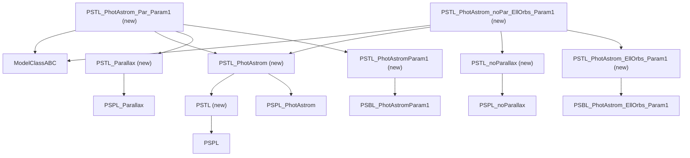
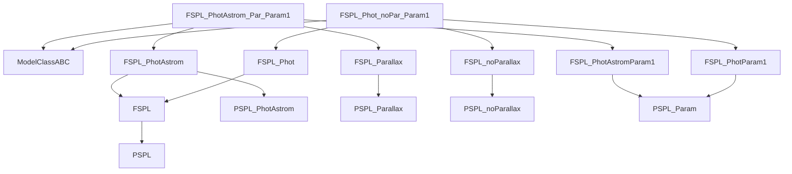
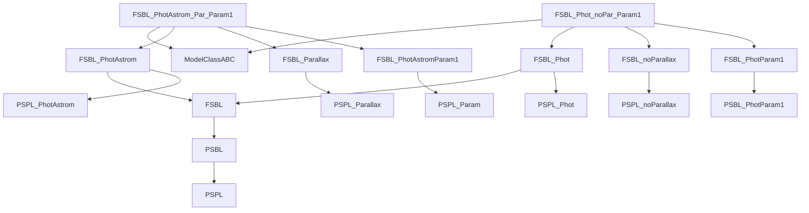
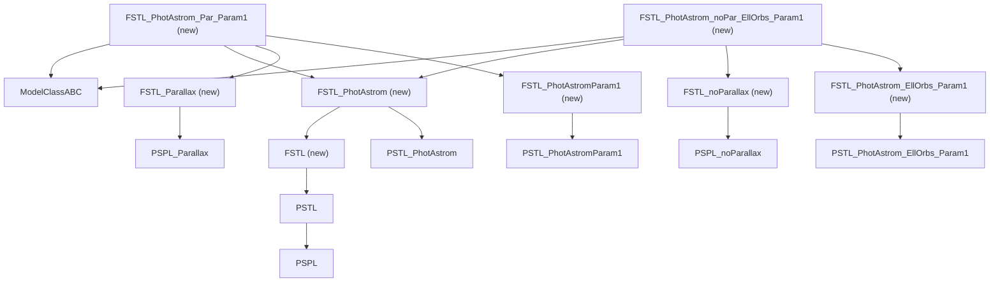
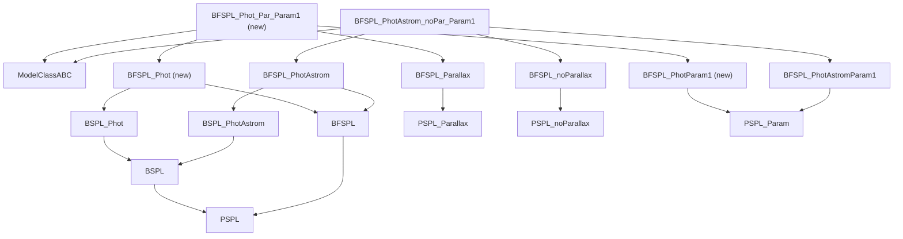
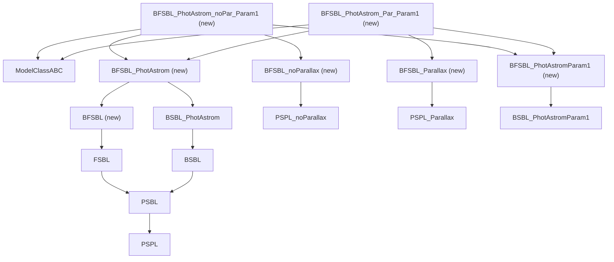

# Finite-source and triple-lens models on `jax_pymc`

Planning note for Jessica. No implementation is in this branch.

Surveyed tree: `origin/jax_pymc` at `64cd87e2b15acfc32b69561a1a56897f7385cbf2`
("Merge per-filter geoproj origin and joint-likelihood slots into jax_pymc").
Line numbers in this note are that commit unless a different branch is
named. I did not run the finite-source tests, and I did not execute
`jax.grad`, `jax.jit`, or a timing comparison. Claims that come from
reading the source only are marked as such.

This note merges two earlier documents: the finite-source survey (now
appendix A) and the literature search on autodiff through caustic
crossings, [`caustic_autodiff_literature.md`](../caustic_autodiff_literature.md)
(condensed in section 4 and the references in section 9).

Contents:

1. Summary and model matrix
2. Proposed implementation, one model at a time, with class diagrams
3. Implementation details and provenance
4. Gradients through caustics
5. Test plan
6. Example notebooks
7. Milestones and branches
8. Risks and open questions
9. References
10. Appendix A: survey of the current tree and the other branches

## 1. Summary and model matrix

Six model families are in scope. Names in the repository:

| Asked name | Class name | Meaning |
| --- | --- | --- |
| PSTL | `PSTL` | Point source, triple lens |
| FSPL | `FSPL` | Finite source, point lens |
| FSBL | `FSBL` | Finite source, binary lens |
| FSTL | `FSTL` | Finite source, triple lens (new) |
| FBSPL | `BFSPL` | Two finite sources, point lens |
| FBSBL | `BFSBL` | Two finite sources, binary lens (new) |

| Model | Lens | Source | Data classes | Concrete leaves | Magnification | Gradient policy | Code comes from | Milestone |
| --- | --- | --- | --- | --- | --- | --- | --- | --- |
| PSTL | 3 points | point | `PSTL_PhotAstrom` | 10 new | degree-10 lens polynomial, companion-matrix roots | host only at first; traced later; caustics same rule as FSBL | port of `origin/jax_dex` `2df0010`, `ea87c40` (Dex Bhadra) | (k) |
| FSPL | 1 point | uniform disk | `FSPL_Phot`, `FSPL_PhotAstrom` | 8 existing | static-outline Bozza contour with closed-form point-lens images | full gradient; no caustic | host speedup from `c913b38` (Natasha Abrams) and `e1bc6ec` (Dex Bhadra); JAX kernel new | (b), (c) |
| FSBL | 2 points | uniform disk | `FSBL_Phot`, `FSBL_PhotAstrom` | 56 existing (`model_jax.py` only) | contour integration on the Witt quintic: static limb (d1), then microlux-style adaptive contour (d2) | gradient off caustics after d1; across caustics after d2 passes the gradient tests | host from `jax_pymc` `model_jax.py`; d2 algorithm after microlux (Ren and Zhu 2025) | (d1), (d2) |
| FSTL | 3 points | uniform disk | `FSTL_PhotAstrom` | 10 new | d2 contour on the PSTL degree-10 polynomial | same as FSBL | new, on ported PSTL and the d2 kernel | (l) |
| BFSPL | 1 point | two uniform disks | `BFSPL_Phot` (new), `BFSPL_PhotAstrom` | 1 existing, 3 new | Lee (2009) integrals on a static Gauss–Legendre grid | full gradient; no caustic | Lee integrals in `model.py`; `jnp` port and phot-only class new | (e) |
| BFSBL | 2 points | two uniform disks | `BFSBL_PhotAstrom` | 2 new | d2 contour evaluated at two source centers | same as FSBL | new | (e), after (d2) |

Headline decisions:

- **Point lenses (FSPL, BFSPL)** use a quadrature that is safe to
  differentiate. There are no image creations or annihilations, so a
  static-shape kernel with `jax.grad` is enough. This is recommendation
  5 of the literature search.
- **Binary and triple lenses (FSBL, FSTL, BFSBL)** use contour
  integration in the style of microlux: implicit-differentiation roots,
  analytic image-position derivatives through a `custom_jvp`,
  `stop_gradient` on the adaptive step, a derivative-aware error
  estimate, and assignment-based image matching. A static-limb version
  (d1) lands first so the host comparison and the class wiring do not
  wait for the adaptive kernel.
- **Do not merge** `jax_dex`, `fspl_speedup`, `new_fspl`, or `bagle-jax`.
  Port named functions by hand onto the multi-location calling
  convention, with attribution.
- **Samplers.** Nested sampling, SMC, and the other gradient-free engines
  stay the default for caustic-crossing fits. NUTS on a caustic-crossing
  FSBL, FSTL, or BFSBL fit is allowed only after the gradient tests in
  section 5 pass for that kernel and the run starts from a known mode.

## 2. Proposed implementation

### How to read the class diagrams

One flowchart per model family. The top row holds one or two concrete
leaves, the classes a user instantiates. An arrow points from a class to
one of its bases. A leaf always has four bases: `ModelClassABC`, a data
class (photometry or photometry plus astrometry), a parallax flag, and a
parameter class. Those continue down to the existing PSPL, PSBL, BSPL,
and BSBL mixins. `(new)` marks a class that does not exist on `jax_pymc`.
Each diagram is followed by the full leaf list in brace notation. Base
classes are checked against `src/bagle/model_jax.py`; `PSTL` bases are
read from `origin/jax_dex:src/bagle/model.py`.

`ModelClassABC` is drawn once per diagram. The `PSPL_Param` root of every
parameter class is drawn only where it is the direct base.

Units used below: `rho` is the source radius in Einstein radii. `radiusS`
is in Einstein radii on phot-only parameter classes and in arcsec on
phot+astrom parameter classes; the phot+astrom classes convert with
`source_radius_thetaE_units` (`model_jax.py` around line 23152). Every
kernel takes `rho` in Einstein radii.

### 2.1 PSTL (point source, triple lens)



Leaves: `PSTL_PhotAstrom_{noPar,Par}_Param{1,2,3}` and
`PSTL_PhotAstrom_{noPar,Par}_EllOrbs_Param{1,2}`. Parameter classes:
`PSTL_PhotAstromParam{1,2,3}` on `PSBL_PhotAstromParam{1,2,3}`, and
`PSTL_PhotAstrom_EllOrbs_Param{1,2}` on
`PSBL_PhotAstrom_EllOrbs_Param{1,2}`.

- **Parameters.** The PSBL parent's parameters plus the third lens:
  Param1 adds `mLt`, `sep12`, `sep13`, `alpha12`, `alpha13`. Param2 and Param3 sample
  `q_12`, `q_13`, `sep12`, `sep13`, `alpha12`, `alpha13` (Param3 with `log10_thetaE`
  and `mag_base`). EllOrbs adds a second Keplerian pair (`omega_sec`,
  `big_omega_ter`, `i_23`, `e_23`, `tp_23`, `a_23`). Separations are mas.
  Per-filter slots are `xS0_E`, `xS0_N`, `b_sff`, `mag_src`,
  `dmag_Lp_Ls`, the same as current `PSBL_PhotAstromParam1`.
- **Kernel.** Host first: `numpy.linalg.eigvals` on the 10×10 companion
  matrix in `model.py`, `jnp.linalg.eigvals` in `model_jax.py`. A traced
  `jax_log_likely_*` comes later, as `src/bagle/jax/pstl.py`, with the
  root tolerance passed as a static argument.
- **Files.** Both `model.py` and `model_jax.py`.
- **Samplers.** Any sampler through the host model at first. Gradient
  samplers only after the traced likelihood exists, and with the
  caustic rule from section 4.

### 2.2 FSPL (finite source, point lens)



Leaves, all existing: `FSPL_Phot_{noPar,Par}_Param{1,2}` and
`FSPL_PhotAstrom_{noPar,Par}_Param{1,2}`. No class is added. The new code
is `jax_log_likely_photometry` on `FSPL_PhotParam{1,2}` and
`FSPL_PhotAstromParam{1,2}`, plus `jax_log_likely_astrometry` on the two
phot+astrom parameter classes.

- **Parameters.** Unchanged. Phot: `t0`, `u0_amp`, `tE`, `piE_E`, `piE_N`,
  `radiusS` (Einstein radii), `b_sff`, `mag_src`. Phot+astrom Param1:
  physical `mL`, `t0`, `beta`, distances, per-filter `xS0_E`, `xS0_N`,
  proper motions, `radiusS` (arcsec), `b_sff`, `mag_src`. `n_outline`
  stays a constructor integer, never sampled.
- **Kernel.** `src/bagle/jax/fspl.py`: a static `n_outline` limb, the
  closed-form point-lens images, and the Bozza contour (area, centroid,
  parabolic correction) as `jnp` reductions, `vmap` over time. It
  returns the magnification and the centroid so the astrometric
  likelihood can be traced. The host reference is the ported vectorized
  AMG.
- **Samplers.** All, including NUTS, BlackJAX NUTS and MCLMC, and replica
  exchange.

### 2.3 FSBL (finite source, binary lens)



Leaves, all existing and only in `model_jax.py`:
`FSBL_Phot_{noPar,Par}_{,EllOrbs_,CircOrbs_}Param1`, and
`FSBL_PhotAstrom_{noPar,Par}_` combined with `Param{1..8}`,
`LinOrbs_Param{1,3,6,7}`, `AccOrbs_Param{1,3,6,7}`,
`EllOrbs_Param{1,3,4,7,8}`, and `CircOrbs_Param{1,3,4,7,8}`, where a
parent PSBL parameterization exists. `FSBL_PhotAstrom_noPar_Param5` and
`_Param7` do not exist; only the `Par` versions do. No class is added
in (d1) or (d2).

- **Parameters.** The PSBL parent's parameters plus `radiusS` (Einstein
  radii on `FSBL_PhotParam1`, arcsec on the phot+astrom classes).
- **Kernel.** `src/bagle/jax/fsbl.py`.
  - d1: fixed `n_outline` limb, no `jnp.insert`, no `jax.random`. The
    existing Witt quintic (`get_image_pos_arr`) gives the images, and a
    static version of `polygonal_area_with_parity` / `integrate_unif`
    does the area. For photometry, the sum of `|1/det J|` over roots on
    the source does not need labeled tracks.
  - d2: a microlux-style adaptive contour with fixed buffers (microlux
    uses 30 starting points and buffers of up to 480). Roots get an
    implicit-differentiation rule (`custom_root` or `custom_jvp`). The
    adaptive loop gets a `custom_jvp` with analytic image-position
    derivatives. The step size goes through `stop_gradient`. A
    derivative-aware error estimate drives refinement near crossings.
    Images are matched across limb points by linear-sum assignment.
- **Wiring.** `jax_log_likely_*` on `FSBL_PhotParam1` and
  `FSBL_PhotAstromParam1` first. Other parameterizations and orbit
  leaves follow, about 100–200 lines each, once Param1 matches the host.
- **Samplers.** After d1: gradient samplers only for trajectories that
  miss the caustics. After d2 and its gradient tests: NUTS on a single
  known mode is allowed; nested sampling and SMC stay the default.

### 2.4 FSTL (finite source, triple lens)



Leaves: `FSTL_PhotAstrom_{noPar,Par}_Param{1,2,3}` and
`FSTL_PhotAstrom_{noPar,Par}_EllOrbs_Param{1,2}`, ten in all, the same
set as PSTL. Parameter classes: `FSTL_PhotAstromParam{1,2,3}` on
`PSTL_PhotAstromParam{1,2,3}`, and `FSTL_PhotAstrom_EllOrbs_Param{1,2}`
on `PSTL_PhotAstrom_EllOrbs_Param{1,2}`. The parallax flags sit on the
PSPL flags, the same as FSBL, so they do not inherit the duplicated
`get_amplification` on the PSTL flags (appendix A.2.5).

- **Parameters.** The PSTL parent's parameters plus `radiusS` in arcsec.
  Phot+astrom only. No phot-only FSTL in this round.
- **Kernel.** `src/bagle/jax/fstl.py`, sharing the d2 contour driver with
  FSBL. The lens equation is PSTL's `_triple_lens_poly_coeffs`
  (degree 10). Up to ten images per limb point, so the assignment step
  and the buffers are larger than FSBL's.
- **Files.** `model_jax.py`, next to FSBL. Whether `model.py` gets a
  NumPy FSTL is open question 9.
- **Samplers.** Same rule as FSBL after d2.

### 2.5 BFSPL (two finite sources, point lens)



Leaves: `BFSPL_PhotAstrom_noPar_Param1` (existing),
`BFSPL_PhotAstrom_Par_Param1` (new), and `BFSPL_Phot_{noPar,Par}_Param1`
(new).

- **Phot+astrom parameters.** `BFSPL_PhotAstromParam1`, after the name
  fix in (a): `fitter_param_names` lists `radiusS_pri`, `radiusS_sec`,
  and `sep` to match `__init__` (they currently list one `radiusS`).
  Radii in arcsec, `sep` in mas, `mag_src_pri`, `mag_src_sec`, and one
  combined `b_sff` per filter, `b_sff = (f_S1 + f_S2) / (f_S1 + f_S2 + f_L + f_N)`.
- **Phot-only data class.** `BFSPL_Phot(BFSPL, BSPL_Phot)`,
  `photometryFlag = True`, `astrometryFlag = False`. It overrides
  `get_photometry` with the two-source sum from
  `BFSPL_PhotAstrom.get_photometry` (`model.py` line 24948).
  `BFSPL.get_photometry` (line 24677) would sum all four images and read
  a single `mag_src`. `get_all_arrays` takes a phot branch: `rho` is
  `radiusS_pri` and `radiusS_sec` directly, with no division by
  `thetaE_amp` and no call to `get_lens_astrometry`.
- **Phot-only parameters.** `BFSPL_PhotParam1(PSPL_Param)`, following
  `BSPL_PhotParam1` (`model.py` 14114):

  ```text
  fitter_param_names = ['t0', 'u0_amp', 'tE', 'piE_E', 'piE_N',
                        'sep', 'phi', 'radiusS_pri', 'radiusS_sec',
                        'mag_src_pri', 'mag_src_sec', 'b_sff']
  filt_param_names = ['mag_src_pri', 'mag_src_sec', 'b_sff']
  filt_param_usage = ['phot', 'phot', 'both']
  ```

  `sep` and both radii are in Einstein radii. Derive `piE_amp`,
  `thetaE_hat`, `u0`, `u0_pri`, `u0_sec`, and `mag_base` the way
  `BSPL_PhotParam1.__init__` does (lines 14186–14260). Do not copy the
  `# mas` comment on BSPL line 14254; the arithmetic and the BSPL phot
  docstring say Einstein radii.
- **Kernel.** `src/bagle/jax/bfspl.py` (or inside `fspl.py`): the Lee
  integrands on a static Gauss–Legendre grid, called once per source.
  The phot+astrom path also returns the image centroids.
- **Samplers.** All.

### 2.6 BFSBL (two finite sources, binary lens)



Leaves: `BFSBL_PhotAstrom_{noPar,Par}_Param1`. The `noPar` leaf lands
first; the `Par` leaf follows once the `noPar` leaf matches the
reference. No phot-only BFSBL, no Param2 and up, no orbit leaves in this
round.

- **Parameters.** `BSBL_PhotAstromParam1` plus `radiusS_pri` and
  `radiusS_sec` in arcsec. Fluxes and `b_sff` follow the BSPL
  convention.
- **Kernel.** `src/bagle/jax/bfsbl.py`: the d2 contour evaluated at the
  two source centers with their own `rho`, then the flux-weighted sum.
- **MRO.** `BFSBL_PhotAstrom(BFSBL, BSBL_PhotAstrom)` linearizes as
  `BFSBL`, `FSBL`, `BSBL_PhotAstrom`, `BSBL`, `PSBL`, …, so the
  `get_all_arrays` that wins is `BFSBL`'s. Confirm this with
  `inspect.getmro` in a test.
- **Samplers.** Same rule as FSBL after d2. This is the most expensive
  model in the set: two binary-lens contours per epoch.

### 2.7 Classes added, by milestone

| Milestone | New mixins and parameter classes | New concrete leaves |
| --- | --- | --- |
| (e) | `BFSPL_Phot`, `BFSPL_PhotParam1` | `BFSPL_Phot_{noPar,Par}_Param1`, `BFSPL_PhotAstrom_Par_Param1` |
| (e), after (d2) | `BFSBL`, `BFSBL_PhotAstrom`, `BFSBL_{noParallax,Parallax}`, `BFSBL_PhotAstromParam1` | `BFSBL_PhotAstrom_{noPar,Par}_Param1` |
| (f), optional | none (parameter classes already exist or are a PSPL GP class plus `radiusS`) | one FSPL GP leaf, one FSBL GP leaf |
| (k) | `PSTL`, `PSTL_PhotAstrom`, `PSTL_{noParallax,Parallax}`, `PSTL_PhotAstromParam{1,2,3}`, `PSTL_PhotAstrom_EllOrbs_Param{1,2}` | 10 PSTL leaves |
| (l) | `FSTL`, `FSTL_PhotAstrom`, `FSTL_{noParallax,Parallax}`, `FSTL_PhotAstromParam{1,2,3}`, `FSTL_PhotAstrom_EllOrbs_Param{1,2}` | 10 FSTL leaves |

## 3. Implementation details and provenance

For each model: what is ported from another branch (with commit and
author), what is rewritten while porting, and what is a new algorithm.
"Rewritten" always includes the multi-location conventions in appendix
A.1.6:

- `filt_idx` on every astrometry and parallax call
- `xS0` with shape `(n_filters, 2)`
- `obsLocation[filt_idx]`
- per-filter `b_sff` and `mag_src`
- tied cube suffixes read inside the traced likelihood the same way
  `_class_vector_slots` does for PSPL

### 3.1 PSTL

**Ported** from `origin/jax_dex:src/bagle/model.py` lines 28589–32301,
Dex Bhadra (`2df0010`, git author `10ay`):

- the `PSTL` and `PSTL_PhotAstrom` methods
- the five parameter classes
- the ten leaves
- the degree-10 coefficient function `_triple_lens_poly_coeffs`, copied
  faithfully and not simplified in the same diff
- the companion-matrix solver `_decic_roots`

**Also ported:** the seventeen prior keys from `ea87c40` into both
`default_priors` dicts. The list is in appendix A.2.5. Keep the current
`b_sff` upper bound of `1.0`, not `ea87c40`'s `1.5`.

**Rewritten while porting:**

- **`model.py` solver.** Uses `numpy.linalg.eigvals`, since `model.py`
  does not import JAX.
- **Per-filter photometry.** `fitter_param_names` includes `b_sff`,
  `mag_src`, and `dmag_Lp_Ls`, with `filt_param_names` and
  `filt_param_usage` as in current `PSBL_PhotAstromParam1`.
- **Parent signatures.** Every `super().__init__` argument list is checked
  against the current PSBL parent.
- **Defects fixed:**
  - parallax is added to `xL3` as well as `xL1` and `xL2`
  - `aleph_23` uses `aleph_sec_23`, not the pair-12 `aleph_sec`
  - the rescaled root tolerance is passed as an argument instead of being
    written to `self.root_tol`
  - the duplicate `get_amplification` on the two flags is removed
  - docstrings that still say "PSBL" or "binary lens" are rewritten

**New:** a traced `jax_log_likely_*` in `src/bagle/jax/pstl.py`, after
the host methods match the reference fixtures.

### 3.2 FSPL

**Ported** host speedup from `origin/fspl_speedup` `c913b38` (Natasha
Abrams; the commit message credits Cursor), as carried to
`origin/jax_dex` `e1bc6ec` / `2e42e1a` (Dex Bhadra):

- **Mixed-time dispatch.** Use the uniform contour when `|u| >= 2 rho` and
  the adaptive mesh only near the Einstein ring, with one preallocated
  output.
- **`amg_numpy` / `amg_contour_integrals`.** Vectorized across epochs,
  with unused limb slots padded to a fixed `maxsamps`.
- **The contour-artifact fix in `c913b38`.** Whoever ports it reads that
  diff and says in a comment what the artifact was.

**Rewritten while porting:**

- **Multi-location conventions.** The ported functions run on the current
  `model.py` and `model_jax.py`.
- **`radiusS` units.** Arcsec when the model has `thetaE_amp`, Einstein
  radii otherwise.
- **One dispatch for both files.** `model.py` and `model_jax.py` choose the
  same path for the same inputs.
- **The `jnp.where` call in the NumPy contour** (`model_jax.py` 23685) is
  removed.
- **AMG return shape.** `get_all_arrays_amg` returns the same shape in
  both files.

**New:** the JAX kernel in `src/bagle/jax/fspl.py` (section 2.2), and
`jax_log_likely_*` on the four FSPL parameter classes. Geometry reuses
`bagle.jax.geometry` where the PSPL derivation exists. The derived
`thetaE_amp` of phot+astrom Param1 is computed inside the traced function
so `mL` and `dL` get a gradient.

**Not ported:** anything else from `fspl_speedup` (Docker, RefPar,
notebooks, `fb5f091`, which comments out classes), and anything from
`bagle-jax` (Hunter Harling, 2024).

### 3.3 FSBL

**Reused from `jax_pymc`** (`model_jax.py`):

- the Witt (1995) quintic and companion-matrix roots (`quintic_roots`,
  `binary_lens_poly_coeffs`, `get_image_pos_arr`, around lines
  25341–25377)
- `polygonal_area_with_parity` (line 25742) and `integrate_unif`
- all FSBL parameter classes and leaves

The docstring cites Bartolić's `caustics` as inspiration. No code from
that repository is vendored.

**Ported as test scenarios only** from `origin/jax_dex` `90f9209` and
`ea87c40` (Dex Bhadra): the parameter vectors in
`test_FSBL_PhotAstrom_Par_Param2`, `standard_FSBL_plot`, and
`standard_FSBL_plot_orb`. The FSBL class body on that branch is not
ported; it would fight the larger `model_jax.py` FSBL.

**Removed:** the adaptive limb that grows with `jnp.insert` inside a
Python loop, and the `jax.random` perturbation of duplicate roots
(`PRNGKey(0)`, around line 25930). Neither can be differentiated
meaningfully.

**New in d1:** the static masked limb kernel described in section 2.3.

**New in d2**, after microlux (Ren and Zhu 2025), ported or reimplemented
with attribution once its license is checked (open question 6):

- implicit-function-theorem derivatives for the polynomial roots
- a `custom_jvp` on the adaptive loop using the analytic image-position
  derivative (their Eq. 16)
- `stop_gradient` on the adaptive step size
- the derivative-aware error estimate, a third-derivative term that
  removes the `dA/dq` spikes at crossings
- linear-sum-assignment image matching for image creation and
  annihilation
- static buffers so the kernel jits

Bozza (2010) supplies the fold-connection terms and the ghost-root
distance test. Twinkle (Wang, Wang and Dong 2025) is a reference for
ghost-image detection and for avoiding cancellation in the polynomial at
small `q`.

### 3.4 FSTL

**New.** No branch has a finite-source triple lens.

- **Classes.** Layered on the ported PSTL (section 2.4).
- **Lens equation.** PSTL's `_triple_lens_poly_coeffs` and companion-matrix
  roots, wrapped with the same implicit-differentiation rule as d2.
- **Contour.** The d2 driver from `fsbl.py`, generalized to a
  variable-degree polynomial and up to ten images.
- **References, not dependencies.** Bartolić's `caustics` (contour
  integration for triple lenses in JAX) and microJAX (Miyazaki and
  Kawahara 2025; triple lens by image-centered ray shooting). Either can
  be an optional oracle in a test through `importorskip`.

### 3.5 BFSPL

**Reused from `jax_pymc`** (`model.py` 24278–24612 and the `model_jax.py`
copy): the Lee et al. (2009) integrands `function_photometry_one` and
`function_photometry_two`, the composite sums, and the image placement
along each source's `u` direction. These stay the host reference.

**Rewritten:** the `fitter_param_names` mismatch on
`BFSPL_PhotAstromParam1` (milestone (a)), and the `get_all_arrays` phot
branch.

**New:**

- the `jnp` port on a static Gauss–Legendre grid, so the accuracy target
  is explicit rather than tied to a fixed Simpson `n = 20`
- `BFSPL_Phot`, `BFSPL_PhotParam1`, and the three new leaves
- `jax_log_likely_*`

No branch has a BFSPL test; the reference fixtures are new runs of the
existing class on `e1bc6ec`.

### 3.6 BFSBL

**New.**

- **Classes.** Section 2.6.
- **Kernel.** The d2 kernel at two source centers, with the BSPL flux
  convention.
- **Do not start from the dead code.** The commented `# class FSBL(ABC):`
  block in `model.py` (around line 28465, an older ray-shooting
  integrator) is not a starting point.

### 3.7 Attribution comment

Put this comment at the top of each ported or reimplemented helper:

- Natasha Abrams (`c913b38`)
- Dex Bhadra: the FSPL port (`e1bc6ec`) and PSTL (`2df0010`, `ea87c40`;
  git author `10ay`)
- Bozza et al. (2021) for the contour
- Lee et al. (2009) for BFSPL
- Witt (1995) for the quintic
- Ren and Zhu (2025, microlux) for the differentiable adaptive contour
- Bartolić's `caustics` as inspiration (not vendored)

## 4. Gradients through caustics

Condensed from the literature search of 2026-10-10. That note marks each
source as verified (full text, abstract page, or README opened) or as
snippet only, and section 9 keeps those labels.

**What is established.** Two published JAX codes give working autodiff
gradients through binary-lens caustic crossings and have been used with
NUTS on real events:

- **microlux** (Ren and Zhu 2025): adaptive contour integration, custom
  root and loop derivatives, and a derivative-aware error estimate.
  - Its key finding: value-based error control does not make the
    derivative converge near caustics. Without the derivative term,
    `dA/dq` spikes at crossings, and VBBL finite differences spike too.
  - NUTS on KMT-2019-BLG-0371, a single-mode run: acceptance 0.88, ESS
    1726 from about 56.7k calls, about five times more efficient than
    emcee.
  - A gradient costs two to three forward evaluations.
  - Limits: linear limb darkening through annuli only, binary lenses
    only, and a known failure on under-sampled "hidden cusps".
- **microJAX** (Miyazaki and Kawahara 2025): binary and triple lenses by
  image-centered ray shooting on a static grid. The Heaviside inclusion
  test is replaced in the JVP by a sigmoid with a tunable steepness.
  - HMC was run on injected events and on OGLE-2014-BLG-0124. One
    synthetic run took about 19 hours on an A100.
  - Forward mode only for the extended source. Slow on CPU.

**What is not established.**

- No result shows HMC mixing across several separated caustic-crossing
  modes. The published runs are single-mode or local-posterior. One
  degenerate-mode event (KMT-2025-BLG-1314) is reported on a web page;
  the paper itself was not opened.
- Bartolić's thesis is said to describe caustic-crossing likelihoods as
  jagged and multimodal. The thesis PDF could not be opened.
- No closed-form boundary-integral derivative of the finite-source
  magnification for general lenses was found. microlux differentiates
  the image-position map and the discretized Green's-theorem sum, not a
  separate adjoint integral.

**Analysis** (the literature note's inference, not from a paper):

- The uniform-disk magnification is continuous across a fold. Its first
  derivative is also continuous, with a square-root onset when the limb
  touches the caustic. The second derivative probably diverges there,
  which matters for mass-matrix adaptation.
- What breaks is the discretization, not the physics: the discretized
  derivative converges more slowly than the value.
- Discontinuous HMC (Nishimura, Dunson and Lu 2017) addresses targets
  that really have jumps. The finite-source likelihood is continuous but
  not smooth at some points, so DHMC is not required.
- A plain fixed-node quadrature of the point-source magnification over
  the disk is not supported near a caustic, because the integrand has an
  inverse-square-root singularity there. It is fine for FSPL and far
  from caustics.

**Sampler policy** for this plan:

- **FSPL and BFSPL.** Every sampler.
- **FSBL, FSTL, and BFSBL after d1.** Gradient samplers only for
  trajectories that miss the caustics. Caustic crossings use MultiNest,
  numpyro NS, BlackJAX NS or SMC, nautilus, or pocoMC.
- **FSBL, FSTL, and BFSBL after d2.** NUTS or MCLMC on a caustic-crossing
  fit only when all of the following hold:
  - the gradient tests G-03 and G-04 in section 5 pass for that kernel
  - the run starts from a mode found by a gradient-free engine
  - `q`, `s`, and `rho` are sampled in log space
  - several chains are run

  Replica exchange differentiates every rung and follows the same rule.
- **Multimodal events.** A mode finder (for example amortized or flow
  proposals) is future work. It is not part of this plan.

## 5. Test plan

All tests run in the `py314` environment with `PYTHONPATH=src`. Speed
tests and notebook execution are marked `slow` (the marker is already
declared in `pyproject.toml`). Speed tests record numbers to JSON under
`tests/psbl_sampler_compare/runs/`, which `.gitignore` already covers.
They do not assert a time; a hard threshold would fail on a slower
machine. A test that should fail when a milestone regresses lands with
that milestone.

Reference fixtures from `origin/jax_dex` are generated once by running
that branch at `e1bc6ec` and stored as `npz` under
`tests/data/jax_dex_finite_source/`, with the commit hash in the file.
The magnitude arrays currently in `test_FSPL_Phot_methods` are not
reused. The current tree has the arrays from before `ea87c40`, and
`ea87c40`'s arrays predate the speedup in `e1bc6ec`. VBBL, MulensModel,
and pyLIMA are not installed here; tests that use them call
`pytest.importorskip`.

| ID | Model | Kind | What is checked | Reference | Tolerance or recorded quantity | File | Milestone |
| --- | --- | --- | --- | --- | --- | --- | --- |
| A-01 | all | accuracy | `model` and `model_jax` host photometry and astrometry agree | existing old-vs-JAX fixtures | existing tolerances, not loosened | `tests/test_model_old_vs_jax.py` | every |
| A-02 | FSPL | accuracy | limb `xL0` uses `xS0[filt_idx]`; two filters give two lens origins | one-filter result | exact for one filter | `tests/test_model_multi_location.py` | (a) |
| A-03 | BFSPL | accuracy | `BFSPL_PhotAstromParam1` constructs from the names the fitter samples | `fitter_param_names` | constructs, no error | `tests/test_model.py` | (a) |
| A-04 | FSPL | accuracy | ported host speedup matches the `e1bc6ec` light curve, phot, `n_outline` 100, 500, 1000 | `e1bc6ec` fixture | relative `1e-3` on magnitude | `tests/test_model.py`, `tests/test_model_jax.py` | (b) |
| A-05 | FSPL | accuracy | mixed-`|u|` phot+astrom light curve (epochs inside and outside `2 rho`) | `e1bc6ec` fixture | relative `1e-3` magnitude, host tolerance on centroid shift | same | (b) |
| A-06 | FSPL | accuracy | JAX kernel against Gauss–Legendre on the Lee integrands, `rho` in `[1e-3, 0.1]`, `u` in `[0, 5]`, including `u < rho` | high-order quadrature | relative `1e-3` | `tests/test_fspl_kernel.py` | (b) |
| A-07 | FSPL | accuracy | JAX kernel against the host | ported host AMG | relative `1e-3` magnification, `1e-3` arcsec centroid | `tests/test_fspl_kernel.py` | (b) |
| A-08 | FSPL, FSBL, FSTL, BFSPL, BFSBL | accuracy | point-source limit: tiny `rho` recovers PSPL, PSBL, PSTL, BSPL, BSBL | point-source model with the same parameters | relative `1e-6` at `rho <= 1e-8`; absolute `1e-4` on the analytic PSPL value for `rho <= 1e-3`, `u > 10 rho` | kernel test files | (b), (d1), (l), (e) |
| A-09 | FSPL | accuracy | traced log-likelihood's predicted magnitudes against host `get_photometry` | host model | relative `1e-5` away from the limb, `1e-3` on a limb-crossing epoch | `tests/test_jax_likelihood.py` | (c) |
| A-10 | FSPL, FSBL, BFSPL | accuracy | two filters, second filter's `xS0` tied to the first | NumPy log-likelihood | `rtol=1e-5`, `atol=1e-4` | `tests/test_jax_likelihood.py` | (c), (d1), (e) |
| A-11 | FSBL | accuracy | tiny source, `FSBL_PhotAstrom_Par_Param2` vector from `test_FSBL_PhotAstrom_Par_Param2` | PSBL, and `e1bc6ec` FSBL | `rtol=1e-6`, `atol=1e-6` | `tests/test_fsbl_kernel.py` | (d1) |
| A-12 | FSBL | accuracy | finite source, `standard_FSBL_plot` vector (`radiusS = 5e-3` arcsec, `n_outline = 600`); time grid built after the model | `e1bc6ec` fixture | relative `1e-3` | same | (d1) |
| A-13 | FSBL | accuracy | elliptical orbit, `standard_FSBL_plot_orb` vector (`EllOrbs_Param7`); compare amplifications, not model objects | `e1bc6ec` fixture | relative `1e-3` | same | (d1) |
| A-14 | FSBL, FSTL | accuracy | d1 static limb and d2 adaptive contour agree on a wide, non-caustic trajectory | each other | relative `1e-4` | `tests/test_fsbl_kernel.py`, `tests/test_fstl_kernel.py` | (d2), (l) |
| A-15 | FSBL, FSTL, BFSBL | accuracy | magnification finite and continuous along fold and cusp crossings, `rho` from `1e-3` to `1e-1` | d2 at four times the buffer | finite everywhere; relative `1e-3` | same | (d2), (l), (e) |
| A-16 | FSBL, FSTL | accuracy | optional external oracle | VBBL or MulensModel (FSBL), `caustics` or microJAX (FSTL), via `importorskip` | relative `1e-3` | same | (d2), (l) |
| A-17 | BFSPL | accuracy | JAX Lee kernel against a long Gauss–Legendre integral, phot and phot+astrom | high-order quadrature | relative `1e-3` | `tests/test_bfspl_kernel.py` | (e) |
| A-18 | BFSPL | accuracy | `BFSPL_PhotAstrom_noPar_Param1`, two nonzero radii, photometry and unresolved astrometry | `e1bc6ec` fixture | relative `1e-3` | `tests/test_model.py` | (e) |
| A-19 | BFSPL | accuracy | phot-only BFSPL, both radii `<= 1e-3`, against `BSPL_Phot` with the same geometry and fluxes | BSPL | relative `1e-3` off the limb, `1e-2` with `u < rho` | `tests/test_model.py`, `tests/test_model_jax.py` | (e) |
| A-20 | BFSPL | accuracy | phot-only against phot+astrom BFSPL at matched `u`, `rho`, flux (`sep / thetaE_amp` and `radiusS_* * 1e3 / thetaE_amp` converted) | phot+astrom model | relative `1e-3` | same | (e) |
| A-21 | BFSBL | accuracy | MRO puts `BFSBL.get_all_arrays` first; both sources' magnifications sum with the BSPL flux convention | two separate FSBL calls | relative `1e-6` | `tests/test_model_jax.py` | (e) |
| A-22 | PSTL | accuracy | `PSTL_PhotAstrom_noPar_Param1`, one filter, photometry and three-lens astrometry | `e1bc6ec` fixture | relative `1e-6` | `tests/test_model.py`, `tests/test_model_jax.py` | (k) |
| A-23 | PSTL | accuracy | two filters; `obsLocation[filt_idx]` reaches the parallax of all three lenses, including `xL3` | one-filter runs | relative `1e-10` | `tests/test_model_multi_location.py` | (k) |
| A-24 | PSTL | accuracy | `mLt` to zero recovers PSBL | `PSBL_PhotAstrom_noPar_Param1` | relative `1e-6` | `tests/test_model.py` | (k) |
| A-25 | FSPL | accuracy | `utilde = 0` linear limb darkening matches uniform FSPL | uniform kernel | relative `1e-3` | `tests/test_fspl_kernel.py` | (f) |
| G-01 | FSPL, BFSPL | gradient | `jax.grad` of the magnification in `u` and `rho`, and of the log-likelihood in `t0`, `tE`, `radiusS` | central differences on the host | relative `1e-4`; finite and nonzero | kernel and likelihood tests | (b), (c), (e) |
| G-02 | FSPL | gradient | gradient at `u = 0` | symmetry | finite (may be zero) | `tests/test_fspl_kernel.py` | (b) |
| G-03 | FSBL, FSTL, BFSBL | gradient | `jax.jacfwd` along a non-caustic light curve in `u0`, `tE`, `rho`, `q`, `s` | high-precision central differences | relative `1e-4` | kernel tests | (d1), (l), (e) |
| G-04 | FSBL, FSTL, BFSBL | gradient | along fold and cusp crossings: no NaN; spike count with and without the derivative-aware estimate | central differences | no NaN; no spike above 10× the local finite-difference value with the estimate on | kernel tests | (d2), (l), (e) |
| G-05 | all traced | gradient | gradient with respect to the tied source slot when `xS0` of filter 2 is tied to filter 1 | central differences | finite and nonzero | `tests/test_jax_likelihood.py` | (c), (g) |
| G-06 | all traced | gradient | a NaN magnification maps to the `-1e300` batch penalty, not a NaN gradient | `evaluate_loglik_jax` | finite log-likelihood and gradient | `tests/test_jax_likelihood.py` | (g) |
| S-01 | all | speed | forward call time for host `model`, host `model_jax`, and the jitted JAX likelihood at `N_times` 256 and 1000 | none | recorded seconds per call | `tests/test_finite_source_timing.py` | each model's milestone |
| S-02 | all traced | speed | `jit` compile time for the first call | none | recorded seconds | same | each |
| S-03 | all traced | speed | gradient cost over forward cost | microlux reports 2–3× | recorded ratio | same | each |
| S-04 | all traced | speed | batched `vmap` throughput over 64 parameter vectors | none | recorded evaluations per second | same | (g) |
| S-05 | FSPL | speed | ported host speedup against the current AMG on the `test_FSPL_Phot_methods` setup | current tree | recorded speedup factor | same | (b) |
| S-06 | FSBL, FSTL | speed | cost against `n_outline` (d1) and buffer size (d2) | none | recorded seconds per call | same | (d1), (d2), (l) |
| S-07 | FSPL, FSBL | speed | sampler scenarios `fspl_rho0p01`, `fsbl_wide` (gradient samplers allowed), `fsbl_caustic` (gradient-free only) | none | recorded wall time, ESS per call, NUTS divergences | `tests/psbl_sampler_compare/run_comparison.py` | (i) |
| S-08 | FSBL, FSTL | speed | short NUTS runs from a known mode at `rho` 1e-3, 1e-2, 1e-1, non-caustic and single-mode caustic | none | recorded acceptance, divergences, ESS per call | same | (d2), (l) |
| N-01 | all | notebook | each notebook in section 6 executes without error | none | runs to completion | `tests/test_notebooks.py` (`jupyter nbconvert --execute`) | each model's milestone |

## 6. Example notebooks

Each model gets one executed notebook in `docs/notebooks/`, named like
the existing notebooks there (`example_PSBL_blended.ipynb`,
`example_multi_location.ipynb`). The notebook lands in the same
milestone diff as the model. These six replace the single
`example_FSPL.ipynb` an earlier draft listed.

| Notebook | Milestone | Leaves plotted | Point-source comparison |
| --- | --- | --- | --- |
| `example_PSTL.ipynb` | (k) | `PSTL_PhotAstrom_noPar_Param1`, `PSTL_PhotAstrom_noPar_EllOrbs_Param1` | `PSBL_PhotAstrom_noPar_Param1` with the same first two masses, to show what the third lens adds. PSTL is already a point source. |
| `example_FSPL.ipynb` | (b), (c) | `FSPL_PhotAstrom_noPar_Param1`, `FSPL_Phot_noPar_Param1` | `PSPL_PhotAstrom_noPar_Param1`, `PSPL_Phot_noPar_Param1` |
| `example_FSBL.ipynb` | (d1), (d2) | `FSBL_PhotAstrom_noPar_Param1`, `FSBL_Phot_noPar_Param1`, one EllOrbs leaf | matching `PSBL_*` leaves; one trajectory misses the caustics, one crosses them |
| `example_FSTL.ipynb` | (l) | `FSTL_PhotAstrom_noPar_Param1`, `FSTL_PhotAstrom_noPar_EllOrbs_Param1` | matching `PSTL_*` leaves |
| `example_BFSPL.ipynb` | (e) | `BFSPL_PhotAstrom_noPar_Param1`, `BFSPL_Phot_noPar_Param1` | `BSPL_PhotAstrom_noPar_Param1`, `BSPL_Phot_noPar_Param1` |
| `example_BFSBL.ipynb` | (e), after (d2) | `BFSBL_PhotAstrom_noPar_Param1` | `BSBL_PhotAstrom_noPar_Param1` |

Every notebook has the same four figures, made with methods the classes
already define:

1. **Light curve.** `get_photometry`, with `get_amplification` on a second
   axis.
2. **Unlensed astrometry.** `get_astrometry_unlensed`, with the lens
   positions from `get_lens_astrometry` or `get_resolved_lens_astrometry`.
3. **Resolved astrometry.** `get_resolved_astrometry`: one track per image,
   colored by image, and by source for the binary-source models.
4. **Lensed astrometry.** `get_astrometry`, plus `get_centroid_shift`
   against time.

Point-source comparison. For each finite-source model, the point-source
model is built from the same parameter dictionary with the radius
arguments removed. Each figure is two panels with shared axes: finite
source on the left, point source on the right. The light curve also gets
a residual panel, finite minus point-source magnitude. A markdown cell
states the units: phot `sep` and radii in Einstein radii, phot+astrom
`sep` in mas and radii in arcsec.

Rules:

- **Size.** One filter and a short time grid, about a minute on a CPU.
- **Models.** `bagle.model` draws the host figures where the class exists
  there. For FSBL, FSTL, and BFSBL, which live only in `model_jax.py`,
  the `model_jax` host methods draw them. Once a model's
  `jax_log_likely_*` exists, one cell overlays the traced prediction.
- **Phot-only leaves** get only the light curve, because their unlensed
  astrometry is in Einstein radii. The astrometry figures use the
  phot+astrom leaf.
- **Parameters** make the finite-source effect visible:
  - `rho` from about 0.01 to 0.05
  - an impact parameter below `rho` for FSPL
  - one caustic crossing for FSBL, FSTL, and BFSBL
- **No fitting.** Do not call `solve()`.
- **Outputs.** Commit the notebooks with their outputs, as the four
  existing notebooks are. Test N-01 executes all of them.

## 7. Milestones and branches

Work on `jax_finite_source`, cut from `jax_pymc` at `64cd87e` or later.
Each milestone is its own short-lived branch and is reviewed as a diff
before it lands. Sizes are lines of diff, estimated from the size of the
current methods, not measured.

Dependency order:

- (a), (b1), and (k) can start together.
- (b2) blocks (c). (c) blocks the FSPL half of (g) and (i).
- (d1) needs nothing from (b) except the test style. (d2) needs (d1).
- (l) needs (k) and (d2).
- BFSPL in (e) needs the point-lens kernel from (b2). BFSBL in (e) needs
  (d2).
- (f) applies to every milestone.
- (j) is last.

| Milestone | Work | Size | Risk | Depends on | Notebook | Tests |
| --- | --- | --- | --- | --- | --- | --- |
| (a) | Fix what exists: per-filter limb `xL0` (`model.py` 24266, `model_jax.py` 25303, 30984); delete the duplicate `FSPL_Limb` (`model_jax.py` 30771); one FSPL dispatch and AMG return shape in both files; remove the `jnp.where` call (`model_jax.py` 23685); align `BFSPL_PhotAstromParam1.fitter_param_names` with `__init__` | 200–400 | low | none | none | A-01, A-02, A-03 |
| (b1) | Port the vectorized FSPL host AMG and `|u|` dispatch | 300–500 | medium (Bozza second differences near the minor image) | (a) | none | A-04, A-05, S-05 |
| (b2) | JAX FSPL kernel in `src/bagle/jax/fspl.py` | 400–800 plus 300 of tests | medium | (b1) | `example_FSPL.ipynb` (host figures) | A-06, A-07, A-08, G-01, G-02, S-01–S-03 |
| (c) | FSPL `jax_log_likely_*`; phot and phot+astrom `radiusS` priors | 400–700 | medium (derived geometry must be traced) | (b2) | add the JAX overlay to `example_FSPL.ipynb` | A-09, A-10, G-01, G-05 |
| (d1) | FSBL static masked limb; `jax_log_likely_*` on FSBL Param1 | 800–1500 | high (root polish, parity, image labels) | (a) | `example_FSBL.ipynb` (non-caustic trajectory) | A-08, A-10–A-13, G-03, S-06 |
| (d2) | microlux-style adaptive contour with custom derivatives, derivative-aware estimate, assignment matching | 1500–2500 | high (hidden cusps, derivative estimator cost) | (d1); license check | add the caustic trajectory to `example_FSBL.ipynb` | A-14–A-16, G-04, S-06, S-08 |
| (e) | BFSPL Lee kernel in JAX, phot-only class and leaves, Par leaf; then BFSBL classes and kernel | 650–1100 for BFSPL; 600–1000 for BFSBL | medium for BFSPL; high for BFSBL | (b2); BFSBL also (d2) | `example_BFSPL.ipynb`, then `example_BFSBL.ipynb` | A-08, A-17–A-21, G-01, G-03, G-04 |
| (f) | Multi-location conventions in every new method; finite-source centroid in the kernels; optional fixed linear limb darkening; optional FSPL and FSBL GP leaves | 150–500 | low to medium | (a)–(c); FSBL GP after (d1) | none | A-25 |
| (g) | Fitter wiring: no new solver; check the tied-slot lookup, batch penalty, and prior tables in both fitters; remove the "FSPL implementation in-progress" sentence (`model_fitter.py` 140, `model_fitter_jax.py` 574) | 50–150 | low | (c), (d1), (e) | none | G-05, G-06, S-04 |
| (h) | Reference fixtures from `e1bc6ec` and the remaining rows of the test table | 300–600 | low | each model's milestone | none | section 5 |
| (i) | Timing scenarios in `run_comparison.py`, note in `tests/PSBL_SAMPLER_COMPARE.md` | 150–250 | low | (c), (g); (d1) for FSBL | none | S-07 |
| (j) | `docs/new_models.rst`: units per parameterization, `b_sff` meaning, sampler policy, PSTL and FSTL paragraphs | a few hundred | low | (c); (d2), (e), (k), (l) for their paragraphs | none | N-01 |
| (k) | PSTL port: classes, prior keys, defect fixes | about 3700 plus a few hundred | medium off caustics; high on them | none | `example_PSTL.ipynb` | A-22–A-24, S-01 |
| (l) | FSTL classes and kernel on the d2 driver | 800–1500 | high (ten images per limb point, cost) | (k), (d2) | `example_FSTL.ipynb` | A-08, A-14–A-16, G-03, G-04, S-06, S-08 |

Suggested branches, each merged into `jax_finite_source` as one diff:

| Branch | Lands | Review focuses on |
| --- | --- | --- |
| `jax_finite_source_a` | (a) | behavior of the existing tests |
| `jax_finite_source_b` | (b1), (b2) | accuracy rows and one `jit` timing |
| `jax_finite_source_c` | (c) | gradient and two-filter tie |
| `jax_finite_source_d1` | (d1) | non-caustic agreement with the `e1bc6ec` fixtures |
| `jax_finite_source_d2` | (d2) | gradient through crossings (G-04), d1 versus d2 agreement |
| `jax_finite_source_e` | (e) | two radii, flux fraction, phot `sep` in Einstein radii; BFSBL MRO |
| `jax_finite_source_fg` | (f), (g) | solvers see the new methods |
| `jax_finite_source_hij` | (h), (i), (j) | fixtures, timing, docs |
| `jax_finite_source_k` | (k) | three-lens astrometry and the defect fixes |
| `jax_finite_source_l` | (l) | triple-lens finite source against PSTL and the optional oracles |

Bring the FSPL speedup and PSTL in by porting the named functions.
Cherry-picks would not apply: `e1bc6ec` is a 1172-line rewrite of an old
`model.py`, and `2df0010` is about 3400 lines against the
pre-multi-location `model.py`. A merge of `jax_dex` is 136 commits the
other way and still leaves `model_jax.py` untouched.

## 8. Risks and open questions

1. **Accuracy against speed.** A static outline that is enough at
   `rho = 0.01` can be wrong at `rho = 0.1` near a cusp, or wasteful at
   `rho = 1e-3`. `n_outline` and the d2 buffer size are chosen per fit
   and reported. There are no timing numbers yet, from Dex's branch or
   from this tree.
2. **Compile time.** Unknown. Do not jit a new shape for every
   `n_outline` a user might type; cache a small set.
3. **Caustics.** Section 4. NUTS is not the default for caustic-crossing
   fits. Please confirm the policy before anyone changes a default.
4. **`radiusS` units and priors.** Phot classes use Einstein radii,
   phot+astrom classes use arcsec (`model.py` 23531 against 23790). One
   prior, `make_gen(1e-4, 1e-2)`, cannot mean both. Which prior should a
   phot+astrom fit use? Phot-only BFSPL also uses `sep` in Einstein
   radii, while the global `sep` prior (`1e-4` to `2e-2`) is the
   phot+astrom interval in mas. What interval should a phot-only
   binary-source separation use?
5. **Limb darkening.** The only law in the tree is linear in `utilde`.
   The recommendation is a fixed value per event, after the uniform
   kernels work. microlux also supports only linear limb darkening.
6. **Licenses.** Check the microlux and `caustics` licenses before
   porting any code from them. If either is incompatible, reimplement
   from the paper, cite it, and copy no code.
7. **Hidden cusps.** microlux reports failures when a cusp is
   under-sampled. A test with a small source passing near a cusp should
   go in A-15. FSTL has more cusps per caustic.
8. **FSTL cost.** A degree-10 eigenproblem per limb point per epoch, with
   up to ten images to match. At 256 epochs and 64 limb points that is
   about 1.6e4 10×10 eigenproblems per call before refinement. It is
   expensive for long NUTS runs. S-06 measures it.
9. **NumPy FSBL and FSTL.** `model.py` has no live FSBL, so the host
   comparison for FSBL, FSTL, and BFSBL is the `model_jax.py` host method
   plus the optional external oracles. Should `model.py` get NumPy
   copies for parity with the other models?
10. **External libraries.** Do not depend on VBBL, MulensModel, pyLIMA,
    microlux, microJAX, or `caustics`. Use them only as optional test
    oracles.
11. **Attribution.** The module authors listed at the top of `model.py`
    include Jessica Lu, Michael Medford, Casey Lam, Dex Bhadra, and
    Edward Broadberry.
    - The FSPL vectorization is Natasha Abrams (`c913b38`), with Dex
      Bhadra's port (`e1bc6ec` / `2e42e1a`); the commit message also
      credits Cursor.
    - The git author `10ay` on `2df0010`, `90f9209`, and `ea87c40` is
      Dex Bhadra: the PSTL classes, the PSTL prior keys, and the FSBL
      tests. The PSTL work is ported in (k). His FSBL body in `90f9209`
      is not ported.
    - Hunter Harling wrote the 2024 `bagle-jax` prototype; it is not
      merged.
12. **Not verified.**
    - I did not run the finite-source tests, `jax.grad`, or `jax.jit`.
    - I did not measure the Dex speedup.
    - I did not diff `c913b38` line by line to name the contour artifact.
    - I did not confirm that every old-vs-JAX FSBL parity row has a NumPy
      twin.
    - I did not read BFSPL's flux sum past `model.py` 24590.
    - The `BFSPL_PhotAstromParam1` name mismatch and the PSTL defects are
      from reading the source, not from running it.
    - The literature claims are as verified as section 9 says, no more.

## 9. References

Labels are from the literature search: verified means the full text,
abstract page, or README was opened; snippet only means only a
search-result abstract was seen.

| Item | Authors, year | Link | Status |
| --- | --- | --- | --- |
| microlux, differentiable binary microlensing by adaptive contour integration | Ren and Zhu, 2025 (AJ) | <https://arxiv.org/abs/2501.07268>, <https://github.com/CoastEgo/microlux> | verified, full text |
| microJAX, differentiable microlensing with image-centered ray shooting | Miyazaki and Kawahara, 2025 (ApJ 994, 144) | <https://arxiv.org/abs/2510.02639>, <https://github.com/ShotaMiyazaki94/microjax> | verified, full text |
| `caustics` (JAX microlensing) and PhD thesis | Bartolić, 2023 | <https://github.com/fbartolic/caustics>, <https://research-repository.st-andrews.ac.uk/handle/10023/27130> | README verified; thesis abstract only |
| PyTorch `caustics` (galaxy-scale strong lensing; a different package, not relevant) | | <https://arxiv.org/abs/2406.15542> | verified from snippets |
| Microlensing with advanced contour integration | Bozza, 2010 | <https://arxiv.org/abs/1004.2796> | verified, full text |
| Twinkle, GPU contour integration | Wang, Wang and Dong, 2025 | <https://arxiv.org/abs/2501.03322> | verified |
| Quadrupole and hexadecapole approximations | Cassan, 2017 | <https://arxiv.org/abs/1703.03600> | verified from search page |
| Finite-source point-lens formalism | Lee et al., 2009 (ApJ 695, 200) | <https://iopscience.iop.org/article/10.1088/0004-637X/695/1/200> | snippet only |
| Discontinuous HMC | Nishimura, Dunson and Lu, 2017 | <https://arxiv.org/abs/1705.08510> | verified |
| Reparameterizing discontinuous integrands | Loubet, Holzschuch and Jakob, 2019 | <https://rgl.epfl.ch/publications/Loubet2019Reparameterizing> | snippet only |
| Edge sampling for differentiable rendering | Li et al., 2018 | <https://people.csail.mit.edu/tzumao/diffrt/> | snippet only |
| Teg, differentiating parametric discontinuities | Bangaru et al., 2021 | <https://people.csail.mit.edu/sbangaru/projects/teg-2021/> | snippet only |
| CausticFlow; neural posterior estimation | not verified; Zhang et al., 2021 (AJ 161, 262) | <https://arxiv.org/html/2607.04955v1> | snippet only |
| KMT-2025-BLG-1314/1392 with microlux | Ren et al., 2026 | <https://coastego.github.io/works/differentiable-modeling-microlensing/> | web page only |
| Witt quintic | Witt, 1995 | cited in `model_jax.py` | not opened |
| Bozza et al. contour with parabolic correction | Bozza et al., 2021 | cited in `model.py` FSPL docstring | not opened |

## 10. Appendix A: survey of the current tree and the other branches

The rest of this note is the earlier survey, kept for the line-number
findings that milestones (a), (b1), and (k) need. Section references
inside it were renumbered to this appendix.

### A.1 Current state on `jax_pymc`

#### A.1.1 What "JAX support" means today

`src/bagle/jax/fspl.py` (68 lines) is a host-NumPy wrapper. Its docstrings say
the contour is "not wired" and that amplification uses the adaptive-mesh path
until a JAX contour exists. Every function calls `model.get_photometry`,
`get_amplification`, `get_astrometry`, or `get_all_arrays` and returns
`numpy` arrays. Nothing in that file is differentiable.

`jax_log_likely_photometry` / `jax_log_likely_astrometry` in `model_jax.py`
stop at line 14965, on a static BSPL parameterization. No class whose name
starts with `FSPL`, `FSBL`, or `BFSPL` defines those methods. The JAX fitter
looks them up with `getattr` (`model_fitter_jax.py` around line 264) and
otherwise cannot trace a finite-source likelihood. `jax_physics.py` has no
finite-source kernel. `src/bagle/jax/` has PSPL, PSBL, BSPL, BSBL, GP, and
orbit helpers, plus the host wrapper above.

Both fitters still say "FSPL implementation in-progress"
(`model_fitter.py` line 140, `model_fitter_jax.py` line 574). The only
finite-source default prior is

```text
'radiusS': ('make_gen', 1E-4, 1E-2)
```

(`model_fitter.py` line 229, `model_fitter_jax.py` line 664). There is no
`rho`, `radiusS_pri`, `radiusS_sec`, or `utilde` prior. `n_outline` is a
constructor integer, not a sampled parameter.

The old-vs-JAX "grad" tests for these classes are finite differences of the
host methods. Example: `test_grad_fspl_photastrom_param1_phot` is documented
as "FSPL phot grad smoke via host AMG finite-difference"
(`tests/test_model_old_vs_jax.py` line 823). A finite-difference pass does
not mean `jax.grad` of a jitted likelihood is finite.

#### A.1.2 FSPL

Present in both `model.py` (line 22303) and `model_jax.py` (line 23136).
Neither copy is marked do-not-use. The two copies are not the same algorithm.

**NumPy (`model.py`)**

- `FSPL.get_all_arrays_CI` (line 22306) is a uniform limb contour. Image
  positions of the outline come from the point-lens lens equation. Area and
  centroid use Green's theorem plus the second-order parabolic correction in
  Bozza et al. (2021), cited in the docstring (Eqs. 9, 10, 19, 21, 22).
  Implementation is vectorized NumPy (`np.diff`, `np.sum` over the outline).
  Amplification divides the image area by `pi * radiusS**2` (line 22419).
- `FSPL.get_all_arrays_amg` (line 22435) is an adaptive mesh on the source
  limb. More samples are added when the limb enters the Einstein ring. The
  point-lens images are the closed form `im_pos1` / `im_pos_all` (line 22476).
  East is real, North is imaginary. The limb is centered on
  `self.xS0[filt_idx]` (confirmed in the AMG body; the contour path uses the
  same `filt_idx` through `get_resolved_astrometry_outline`). The body is a
  Python loop over epochs, which is the slow path the Dex speedup replaces.
- `FSPL.get_all_arrays` (line 22666) dispatches on `astrometryFlag`:
  astrometry always takes AMG; photometry always takes the uniform contour.
  It does not switch on `|u|` versus `rho`.
- Photometry (`get_photometry`, line 22729) sums the two image
  amplifications, converts `mag_src[filt_idx]` to flux, and blends with the
  per-filter source flux fraction `b_sff[filt_idx]`.
- Astrometry lives on `FSPL_PhotAstrom` (line 22780). The unresolved position
  is the magnification-weighted centroid of the two images. The centroid
  integrals are the same Bozza contour, so the finite-source astrometric
  shift is the difference between that centroid and the unlensed source.
  `src/bagle/jax/fspl.py` `fspl_centroid_shift_from_model` reports that shift
  in mas, still via the host method.
- `get_u` (line 22677) is the usual rectilinear track plus
  `parallax.parallax_in_direction(..., obsLocation=self.obsLocation[filt_idx])`.
  Per-filter observers are already threaded here.

**`model_jax.py` FSPL is still host NumPy, with a few `jnp` calls mixed in**

- `im_pos_all` (line 23144) uses `jnp.conjugate` on values produced by NumPy.
- `get_all_arrays_amg` (line 23164) returns six arrays (areas and centroid
  components), not `(images, amps)`. `get_all_arrays_amg_only` (line 23347)
  returns the `(images, amps)` pair. The dispatcher (line 23726) sends
  astrometry to `get_all_arrays_amg_only` and photometry to
  `get_all_arrays_CI`.
- `get_all_arrays_CI` (line 23569) is the Bozza contour in NumPy, then, if
  the object has `xS0`, `muS`, and `thetaE_amp`, it does `jnp.where` on
  `|u| <= 2 * radiusS` (line 23685) and unpacks `get_all_arrays_amg` into
  the six area/centroid arrays. `jnp.where` with one argument returns a
  tuple of index arrays. I did not execute this branch. It is not the
  photometry path of a phot-only model (those usually lack `xS0`), and it is
  not the astrometry path (that uses `amg_only`). It is a landmine if CI is
  called on a phot+astrom object. The local name
  `radiusS = self.source_radius_thetaE_units()` (line 23608) is the radius
  in Einstein-radius units; the amplification denominator at line 23707
  still divides by `self.radiusS**2`. Whether those two uses are consistent
  depends on the units of the outline, which I did not trace through a run.

**Parameter classes (both files, unless noted)**

| Class | Role | `radiusS` unit |
| --- | --- | --- |
| `FSPL_PhotParam1` (`model.py` 23505) | `t0`, `u0_amp`, `tE`, `piE_E`, `piE_N`, `radiusS`, `b_sff`, `mag_src` | Einstein radii (`model.py` 23531; phot-only `rho = self.radiusS` at 23434) |
| `FSPL_PhotParam2` | `piEN_piEE` style, same radius | Einstein radii (`source_radius_thetaE_units` docstring, `model_jax.py` 23157) |
| `FSPL_PhotAstromParam1` (`model.py` 23748) | physical: `mL`, `t0`, `beta`, distances, per-filter `xS0_E`/`xS0_N`, proper motions, `radiusS`, `b_sff`, `mag_src` | arcsec (`model.py` 23790) |
| `FSPL_PhotAstromParam2` | inherits `PSPL_PhotAstromParam2` plus the source radius | arcsec on the physical side; confirm before fitting |
| `FSPL_noParallax`, `FSPL_Parallax` | flags only | |

Concrete leaves, both files: `FSPL_Phot_{noPar,Par}_Param{1,2}` and
`FSPL_PhotAstrom_{noPar,Par}_Param{1,2}` (`model.py` 27660–27751,
`model_jax.py` 35085–35192). Eight leaves. No geoproj leaf, no RefPar leaf,
no GP leaf. `filt_param_names` on the phot+astrom Param1 are
`xS0_E`, `xS0_N`, `b_sff`, `mag_src`, with usage `astrom`, `astrom`, `both`,
`phot`. That matches the multi-location convention. `xS0` storage as
`(n_filters, 2)` is inherited from `PSPL_Param` and is already on this
commit.

**Tests**

- Host tests in `tests/test_model.py` and `tests/test_model_jax.py`:
  source astrometry, centroid shift, boundary, lens astrometry, lens origin,
  phot+astrom methods, phot methods, and (JAX file only)
  `test_refpar_and_fspl_param_lists_match_numpy`,
  `test_fspl_photparam1_numpy_matches_jax`.
- `tests/test_model_multi_location.py` `test_fspl_filt_idx_reaches_astrometry`
  (line 130).
- `tests/test_model_old_vs_jax.py`: parity and host finite-difference grad
  for Phot Param2, PhotAstrom Param1 and Param2, extended methods, outline,
  and resolved astrometry. I did not re-run them for this plan. A previous
  session saw long old-vs-JAX runs abort inside a JAX compile (signal 6);
  those aborts were not treated as finite-source bugs.

**Missing or broken**

- No traced likelihood, so MultiNest can call the host model but NumPyro,
  BlackJAX NUTS/MCLMC, and replica exchange cannot differentiate it.
- `model.py` and `model_jax.py` dispatch and AMG return shapes differ.
- One default prior covers both an Einstein-radius `radiusS` (phot) and an
  arcsec `radiusS` (phot+astrom). `1e-2` arcsec is about 10 mas.
- No FSPL GP parameterization and no concrete GP leaf.
- Limb darkening is a separate, unfinished hierarchy (next subsection).

#### A.1.3 FSPL limb darkening

`FSPL_Limb` (`model.py` 24051, and twice in `model_jax.py` at 25090 and
30771) integrates a linear limb-darkening law in the radial coordinate.
`F(r)` is the standard linear-law cumulative weight with coefficient
`utilde` in `[0, 1]` (`model.py` 24052). `get_amplification` (line 24114)
loops over `nr` annuli in Python and over times in Python. `0` is uniform;
`1` is fully darkened at the limb. There is no Claret four-parameter law,
no quadratic law, and no per-filter coefficient.

`FSPL_Limb_PhotAstromParam1` is marked "DO NOT USE -- in progress"
(`model.py` 24219, `model_jax.py` 25256 and 30937). It does not go through
`PSPL_Param`'s per-filter `xS0` stacking in the usual way: it sets

```text
self.xL0 = self.xS0[0] - self.thetas0 * 1e-3
```

at `model.py` 24266, `model_jax.py` 25303, and `model_jax.py` 30984. The
comment says "Filter 0 East/North origin." For `n_filters > 1` this pins the
lens to filter 0's origin and ignores the other filters. The second copy in
`model_jax.py` is a duplicate class body (the second definition wins at
import time). There is no concrete `ModelClassABC` leaf for the limb
classes, and no fitter prior for `utilde` or `nr`.

The commented block at `model.py` 28465 (`# class FSBL(ABC):` and the
parallax/orbit stubs through about 29431) is dead code. It mentions
`utilde` and an older ray-shooting / cluster integrator. It is not the live
FSBL.

#### A.1.4 FSBL

Live FSBL exists only in `model_jax.py`, class `FSBL(PSBL)` at line 25314.
`model.py` has no live `class FSBL`. The docstring says the magnification is
"inspired by `caustics` by F. Bartolic" and links
`https://github.com/fbartolic/caustics`. I did not read that repository's
license, and this tree does not vendor it. The polynomial and the contour
are written out in `model_jax.py`.

Algorithm, from reading the methods (not from a run):

- Binary-lens images: Witt (1995) quintic, companion-matrix eigenvalues
  (`quintic_roots`, line 25341; `binary_lens_poly_coeffs`, line 25352).
  `get_image_pos_arr` (line 25377) `vmap`s one root solve per limb point and
  rejects roots that fail the lens equation (`root_tol`, floor `1e-8`).
- Finite source: `images_on_source_limb` (line 25888) starts from a uniform
  limb, then for `fsbl_niter = 10` iterations inserts points where the image
  tracks jump. The insert uses `jnp.insert` inside a Python `for` loop.
  After the loop it perturbs duplicate roots with
  `jax.random.uniform` from `PRNGKey(0)` (line 25930). The limb length
  therefore depends on `n_outline` and `fsbl_niter`, which are Python ints,
  and the sample locations depend on the data.
- `magnification_one` (line 25938) permutes image tracks, splits closed and
  open segments, and integrates with `vmap` and `lax.cond`. Magnification is
  signed area over `pi * rho**2`.
- `get_all_arrays_CI` (line 26002) `vmap`s `magnification_one` over times.
  The source position `u` and the two lens positions are computed with the
  NumPy `get_u` and `get_resolved_lens_astrometry` first, then cast to JAX.
  Photometry uses `rho = self.radiusS` (Einstein radii, the PSBL convention).
  Astrometry converts `radiusS` arcsec through `source_radius_thetaE_units`
  (line 25335).
- `get_all_arrays` (line 25474) returns four arrays: images, parity,
  amplification, per-image area. That is a different signature from FSPL's
  `(images, amps)`. `fspl_resolved_amplification_from_model` assumes a
  two-tuple and will mis-unpack FSBL (`jax/fspl.py` line 52).

Differentiability, from the structure, not from `jax.grad`:

- The inner root solve and the area sum are JAX ops, so a fixed limb could
  be differentiated.
- The adaptive insert changes which limb samples exist as a function of the
  parameters. Under `jit`, the Python loop is unrolled only if `niter` and
  the number of inserted points are static. The indices are data-dependent.
  I do not know whether this traces. I would not put it under NUTS until
  someone runs `jax.jit` and `jax.grad` on `magnification_one` alone.
- `jax.random` inside the limb makes the magnification a noisy function of
  a fixed seed. A gradient through that perturbation is not a gradient of
  the physical magnification.
- The outer method is not a pure JAX function because parallax and orbits
  are NumPy.
- At a caustic, image tracks appear and disappear and the Jacobian
  determinant crosses zero. The magnification of a finite source stays
  finite; its derivative with respect to source position is large and, for
  an unsmoothed contour, can jump when a segment is classified as closed or
  open. That is a bad target for HMC. Nested sampling and SMC do not need
  that derivative.

**Parameter classes** (`model_jax.py` only), all subclassing the matching
PSBL parameterization and adding `radiusS`:

- Phot: `FSBL_PhotParam1` (27047). Orbit phot: `FSBL_Phot_EllOrbs_Param1`,
  `FSBL_Phot_CircOrbs_Param1`.
- Phot+astrom Param1 through Param8, plus Lin/Acc/Ell/Circ orbit variants
  where the PSBL parent exists (27140–30201).
- GP parameter containers only: `FSBL_GP_PhotParam1`,
  `FSBL_GP_PhotAstromParam1`, `FSBL_GP_PhotAstromParam2` (30522–30679).
  Nothing inherits them. There is no instantiable FSBL GP model.

Concrete leaves are the long `ModelClassABC` list at 33491–34096 (phot,
phot+astrom, noPar/Par, and the orbit flavors). No RefPar leaf and no
geoproj leaf.

**Tests:** `tests/test_model_old_vs_jax.py` has parity and host
finite-difference tests for Phot Param1, orbit phot, PhotAstrom Param1–8,
and resolved methods. `tests/test_psbl_roots.py`
`test_fsbl_images_on_source_limb_uses_fast_solver` (line 132) checks the
root solver, not a full light curve against VBBL. Because `model.py` has no
live FSBL, "parity" here is the JAX-file class against itself or against a
fixture path in `tests/model_old_vs_jax_fixtures.py`. I did not open every
fixture. Treat a green parity row as "the host method runs," not as "the
likelihood is jitted."

#### A.1.5 BFSPL

`BFSPL` is "Binary Finite-Source, Point-Lens": two sources, one lens
(`model.py` 24278, `model_jax.py` 30998). The magnification is not the
Bozza contour. `get_all_arrays` (model.py 24281) integrates the Lee et al.
(2009) finite-source point-lens expressions (the comment cites ApJ 695, 200)
with a fixed Simpson-style sum, `n = 20` (doubled when `u` is inside the
source). Each source has its own `rho` (`radiusS_pri`, `radiusS_sec` in
arcsec, converted at line 24557) and its own `u` (`u_pri`, `u_sec` from
`get_u`, line 24547). Image positions are placed along each source's `u`
hat, scaled by the centroid integrals. The two sources are then combined
with their fluxes (`mag_src_pri`, `mag_src_sec`). I did not read the flux
combination line by line past 24599; the fitter names are `mag_src_pri` and
`mag_src_sec`, and `b_sff` is one source-flux-fraction array per filter
(both sources together over total flux), matching the BSPL convention in
the BSPL docstring at `model_jax.py` 14931:
`b_sff = (f_S1 + f_S2) / (f_S1 + f_S2 + f_L + f_N)`.

The sum is a Python loop over times and over the 20 abscissae. It is NumPy.
The `model_jax.py` copy is the same structure (class at 30998,
`get_all_arrays` at 31001). `jax/fspl.py` special-cases BFSPL with a
different `swapaxes` than FSPL (line 54).

**Classes.** `BFSPL_PhotAstrom`, `BFSPL_noParallax`, `BFSPL_Parallax`,
`BFSPL_PhotAstromParam1` (`model.py` 25042). The Param1 `fitter_param_names`
list `radiusS` once (line 25120) while `__init__` takes `radiusS_pri`,
`radiusS_sec`, and `sep` (line 25139). That mismatch will confuse the cube
builder; I did not instantiate the class. The only concrete leaf is
`BFSPL_PhotAstrom_noPar_Param1` (model.py 27643, model_jax.py 35067). No
parallax leaf, no phot-only leaf, no GP, no RefPar, no geoproj.

A phot-only parameterization is part of milestone (e). It does not exist
yet. `BFSPL.get_all_arrays` always converts
`radiusS_* * 1e3 / thetaE_amp` (line 24557) and calls
`get_lens_astrometry` (line 24571), so a phot class cannot reuse that
path unchanged. The base `get_photometry` (line 24677) sums every image
and reads one `mag_src`. The two-source flux sum that should be copied
is `BFSPL_PhotAstrom.get_photometry` (line 24948).

**Tests:** `test_parity_bfspl_photastrom_param1` and
`test_grad_bfspl_photastrom_param1` in `tests/test_model_old_vs_jax.py`
(lines 1099 and 1618). Host finite differences again.

#### A.1.6 Multi-location conventions these classes must keep

Already true for the live FSPL and BFSPL phot+astrom parameterizations, and
for FSBL because it subclasses PSBL:

- `xS0` stored as `(n_filters, 2)` for every filter count, including one.
- `xS0_E` and `xS0_N` are length `n_filters`.
- `obsLocation[filt_idx]` in `get_u`.
- `b_sff` and `mag_src` (or `mag_src_pri` / `mag_src_sec`) are per-filter
  arrays. The name is source flux fraction.
- Cube suffixes are 1-based. `tie_fit_param` must be read inside the traced
  likelihood the same way `_class_vector_slots` does for PSPL, or the
  tied-origin bug returns.
- `filt_idx` is 0-based and is an argument of `get_u`, `get_photometry`,
  and `get_astrometry`.

Not true:

- The three `FSPL_Limb_PhotAstromParam1` assignments of `xL0` from
  `xS0[0]` only.
- FSBL GP containers have no concrete model, so they never see a cube.
- A new BFSBL class does not exist to violate or follow the convention.

Geoproj and RefPar finite-source classes do not exist. `get_geoproj_ast_params`
on the PSPL base already takes `filt_idx` and converts `xS0[filt_idx]` with
Earth's parallax offset. A finite-source geoproj leaf can call that later.
Do not invent one in the first milestone.

### A.2 Other branches

#### A.2.1 `origin/jax_dex`

Tip `e1bc6ec` (2026-09-16), Dex Bhadra, "FSPL speedup from the fspl_speedup
branch". Merge-base with `jax_pymc`:

```text
b1b2579142f07ff704634f59711184ce6b7c6c5e
2026-05-11  Faster PSBL runtimes
```

`git rev-list --left-right --count origin/jax_pymc...origin/jax_dex` is
**136 left, 4 right**. The four commits on the Dex side are:

| Commit | Author | Subject |
| --- | --- | --- |
| `e1bc6ec` | Dex Bhadra | FSPL speedup from the fspl_speedup branch (`model.py` only, +554/−618) |
| `ea87c40` | Dex Bhadra (`10ay`) | Adding PSTL model_fitters and FSBL tests |
| `90f9209` | Dex Bhadra (`10ay`) | FSBL Changes |
| `2df0010` | Dex Bhadra (`10ay`) | New PSTL |

`git diff --stat` from the merge-base touches only `src/bagle/fake_data.py`,
`src/bagle/model.py` (about +5087), `src/bagle/model_fitter.py` (+17), and
`tests/test_model.py` (+378). There is no `model_jax.py` and no `src/bagle/jax/`.

`git merge-tree origin/jax_pymc origin/jax_dex` reports content conflicts in
`src/bagle/model.py` and `tests/test_model.py` only. That understates the
scientific drift: `jax_pymc` has since split the JAX models into
`model_jax.py`, changed `xS0` to `(n_filters, 2)`, and added the fitter cube.
A clean merge would still leave the speedup in the NumPy file and the live
JAX classes untouched.

What the speedup actually is (read from `origin/jax_dex:src/bagle/model.py`
around 20773–20870, not timed):

- NumPy, not `jax.grad`. `import jax` / `jnp` in that file is the older
  binary-lens polynomial code, mixed with `np.asarray` of JAX results
  (for example the root check near line 5519 of that file). I did not find
  a `jax.jit` or `jax.grad` call on the FSPL contour.
- `FSPL.get_all_arrays` vectorizes over time. If every epoch has
  `|u| >= 2 rho`, it uses the uniform contour. If every epoch is close, it
  uses AMG. If the light curve is mixed, it splits the times and fills a
  preallocated `(n_times, 2, 2)` image array. The comment in that method
  says the far path "is fully vectorized over times."
- `get_all_arrays_amg` preallocates up to `maxsamps = 1000` (5000 if
  `n_outline` is large) and pads unused slots by repeating the first point.
  The comment says adaptive sampling is sequential in angle and independent
  across times, so every epoch is updated together. Helpers are named
  `amg_numpy` and `amg_contour_integrals`.
- No accuracy number and no speed number are in the commit message. I did
  not benchmark it. The parent commit on `fspl_speedup` says the numerical
  artifact in the contour was fixed; I did not compare light curves.

Dex Bhadra's three commits under the git author `10ay` add PSTL, the
PSTL fitter priors, and FSBL tests on top of the single `model.py`.
The FSBL class on that branch starts at line 22388 of
`origin/jax_dex`'s `model.py`. `jax_pymc` already has a larger FSBL in
`model_jax.py`. Porting that FSBL body would fight that code. PSTL is a different lens (three point masses). Jessica asked
for it, so it is ported as its own milestone. What to bring across is
in appendix A.2.5. The FSBL and FSPL material on this branch is used as
numerical reference cases for new tests (milestone (h) and section 5), not
as a second FSBL implementation.

#### A.2.2 `origin/fspl_speedup`

Tip `7b9f5bc` (2026-10-01), nsabrams, "add log10_piE to default priors".
Merge-base `e77c6a8` (2025-12-05). **142 commits on `jax_pymc`, 72 on
`fspl_speedup`.**

The finite-source commits worth knowing:

| Commit | Author | What |
| --- | --- | --- |
| `c913b38` | nsabrams | "FSPL speedup from vectorizing over shared number of bins in number of samples, fixed source parallax, and fixed contour numerical artifact with cursor." `model.py` only, +150/−135. This is the original vectorization. |
| `2e42e1a` | Dex Bhadra | Same message as `e1bc6ec`. Dex's `jax_dex` commit is this work brought onto `jax_dex`. |
| `fb5f091` | nsabrams | "comment out broken fspl classes" |
| `e6b4547` | | `fspl_photastromparam3` |

`git merge-tree` against `jax_pymc` conflicts in `pyproject.toml`,
`src/bagle/data.py`, `src/bagle/model.py`, `src/bagle/model_fitter.py`,
`tests/conftest.py` (add/add), `tests/test_frame_convert.py`, and
`tests/test_model_fitter.py`. The other ~70 commits are docker, RefPar,
plot notebooks, and fitter bookkeeping that `jax_pymc` has either re-done
or does not want. Merging this branch is not realistic.

Same conclusion as `jax_dex`: the useful piece is a NumPy vectorization of
the FSPL limb, plus a claimed contour-artifact fix. No published error or
timing in the message. Attribute the algorithm to Natasha Abrams
(`c913b38`) and the `jax_dex` port to Dex Bhadra (`e1bc6ec` / `2e42e1a`).
The commit message also says the vectorization was done with Cursor; keep
that in the attribution comment if the code is ported.

#### A.2.3 `origin/new_fspl` and `origin/bagle-jax`

`origin/new_fspl` tip `d88e856` (2025-07-17, Jessica Lu, "Merge branch 'dev'
into new_fspl") **is** the merge-base. `jax_pymc` is 235 commits ahead and
`new_fspl` is 0 ahead. There is nothing to port.

`origin/bagle-jax` tip `ba4001f` (2024-05-27, Hunter Harling). Merge-base
`256daa42` (2023-01-27). **530 commits on `jax_pymc`, 15 on `bagle-jax`.**
`merge-tree` conflicts include an add/add on `src/bagle/model_jax.py` and
`tests/test_model_jax.py`. That `model_jax.py` is an early 10k-line file.
Do not merge it.

No remote matches `jax_dex_*` other than `origin/jax_dex`. I also looked at
`origin/jax_pymc_hi` only as a name in the branch list; I did not review it
for finite-source code.

#### A.2.4 What to port, and what to rewrite

Port by hand, with an attribution comment, from `origin/jax_dex`
`FSPL` (or equivalently `c913b38` / `2e42e1a` on `fspl_speedup`):

- The mixed-time dispatch: uniform contour when `|u| >= 2 rho`, adaptive
  mesh only near the Einstein ring, one preallocated output.
- `amg_numpy` / `amg_contour_integrals`: vectorize across epochs, pad unused
  limb slots to a fixed `maxsamps`.

Rewrite while porting, because the old functions sit on pre-multi-location
`model.py`:

- `filt_idx` on every astrometry and parallax call.
- `xS0[filt_idx]` as the East/North pair, never `xS0[0]` as East.
- `obsLocation[filt_idx]`.
- `radiusS` unit: arcsec when `thetaE_amp` exists, Einstein radii otherwise
  (`source_radius_thetaE_units` already states this in `model_jax.py` 23152).
- Apply the same dispatch in **both** `model.py` and `model_jax.py`. The
  speedup on `jax_dex` does not touch `model_jax.py`, and the two files have
  already drifted (AMG return shape, `amg_only`, the `jnp.where` branch).

Also port, by hand, Dex Bhadra's PSTL classes and the matching default
priors (`2df0010`, `ea87c40`; git author `10ay`). Details and the
defects to resolve while porting are in appendix A.2.5 and milestone (k).
A cherry-pick of `2df0010` is a 3400-line patch against the
pre-multi-location `model.py` and will not apply.

Do not port:

- Dex Bhadra's FSBL body from `90f9209`. `model_jax.py` FSBL is the one the tests call.
  Use that commit's tests as scenarios and as a source of parameter
  vectors (milestone (h)), and regenerate the numbers on `e1bc6ec`.
- Anything from `bagle-jax`.
- A wholesale `model.py` from `fspl_speedup` (includes `fb5f091`, which
  comments classes out).

The JAX kernel in milestone (b) is new code. The Dex/Abrams work makes the
host reference faster; it does not provide `jax.grad`.

#### A.2.5 Dex Bhadra's PSTL, from `origin/jax_dex`

Read from `origin/jax_dex:src/bagle/model.py` at `e1bc6ec`. I did not
instantiate the classes. Line numbers are that file.

`PSTL(PSPL)` starts at line 28589 and the last concrete leaf ends at
line 32301, about 3700 lines. Most of that length is the expanded
degree-10 lens polynomial. The image solver is a 10×10 companion matrix
(`_decic_roots`, line 28689) and `jnp.linalg.eigvals`. Coefficients are
`_triple_lens_poly_coeffs` (line 28707), documented as the caustics-frame
triple-lens equation. `get_all_arrays` (line 30179) rescales the source
and the three lenses into a unit box, solves, scales the images back,
and returns `(images, amps)`. Amplification is `1/|J|` with three mass
terms (`get_amp_arr`, line 28596). There is no `radiusS` and no limb.

`get_resolved_lens_astrometry` (line 30564) returns a stack of three
lens positions. With `orbitFlag == False`, lens 1 and lens 2 sit at
`±sep12/2` along `alpha12`, and lens 3 sits at lens 1 plus `sep13`
along `alpha13`. With Keplerian motion, two `orbits.Orbit` objects are
integrated: pair 1–2 (`omega_pri`, `big_omega_sec`, `i_12`, `e_12`,
`tp_12`, `a_12`) and pair 2–3 (`omega_sec`, `big_omega_ter`, `i_23`,
`e_23`, `tp_23`, `a_23`). The orbit path calls `oal2xy`, which needs a
NumPy time array. Parallax uses `obsLocation[filt_idx]` already.

Parameter classes, all subclassing the matching PSBL class and adding
the third mass:

| Class | Sampled geometry beyond the PSBL parent |
| --- | --- |
| `PSTL_PhotAstromParam1` (31207) | `mLt`, `sep12`, `sep13`, `alpha12`, `alpha13`. `q_12 = mLs/mLp`, `q_13 = mLt/mLp`. `m3` from `mLt` and the distance difference |
| `PSTL_PhotAstromParam2` (31302) | `q_12`, `q_13`, `sep12`, `sep13`, `alpha12`, `alpha13` |
| `PSTL_PhotAstromParam3` (31422) | same ratios and separations, with `log10_thetaE` and `mag_base` |
| `PSTL_PhotAstrom_EllOrbs_Param1` (30868) | `mLt` and a second Keplerian (`i_23`, `e_23`, `tp_23`, `a_23`, `omega_sec`, `big_omega_ter`) |
| `PSTL_PhotAstrom_EllOrbs_Param2` (31044) | `q_12`, `q_13` and the same second Keplerian |

Photometry parameters on that branch are still the old split:
`phot_param_names = ['b_sff', 'mag_src', 'dmag_Lp_Ls']` (Param3 uses
`mag_base`). `jax_pymc` no longer stores photometry that way. Current
`PSBL_PhotAstromParam1.fitter_param_names` includes `b_sff`, `mag_src`,
and `dmag_Lp_Ls`, and `filt_param_names` / `filt_param_usage` name the
per-filter slots. The port has to follow that, and `xS0` has to be
`(n_filters, 2)`. The `super().__init__` argument lists were written
against the PSBL classes as of May 2026. Check them against the current
signatures before calling through; do not assume they still match.

Ten concrete leaves, lines 32202–32301:

- `PSTL_PhotAstrom_{noPar,Par}_Param{1,2,3}`
- `PSTL_PhotAstrom_{noPar,Par}_EllOrbs_Param{1,2}`

No phot-only leaf, no GP leaf, no RefPar leaf, no geoproj leaf. No
`jax_log_likely_*`. `model_jax.py` does not exist on this branch, so
both copies on `jax_pymc` are new. `tests/test_model.py` on `jax_dex`
has no `PSTL` test.

The fitter change is `ea87c40`, `src/bagle/model_fitter.py` only, seventeen
added lines in `default_priors`. There is no new solver class. Current
`model_fitter.py` (line 185) and `model_fitter_jax.py` (line 619) are
both missing every one of these keys:

```text
mLt          make_gen          0, 100
beta_com     make_gen          -2, 2
q_12, q_13   make_gen          0.001, 1
alpha12, alpha13  make_gen     0, 360
sep12, sep13    make_gen       1e-4, 2e-2
omega_sec    make_gen          -180, 180
big_omega_ter  make_gen        -180, 180
i_12, i_23   make_gen          -90, 90
e_12, e_23   make_gen          0, 0.9
tp_12, tp_23 make_gen          0, 10000
a_12, a_23   make_gen          1e-4, 2e-2
```

`ea87c40` also inserts `'b_sff': ('make_gen', 0.0, 1.5)`. Current
`jax_pymc` already has `b_sff` with upper bound `1.0`
(`model_fitter.py` line 206, the comment says astrometry clips a
negative lens flux). Keep `1.0`. Add the keys above to both prior
dicts and leave the generators as Dex Bhadra wrote them in `ea87c40`.

Defects I would not copy silently, all from reading:

- Parallax is added to `xL1` and `xL2` only (`model.py` 30646–30652).
  `xL3` is left unshifted, then all three are stacked.
- `PSTL_PhotAstrom_EllOrbs_Param1` sets
  `self.aleph_23 = self.a_23 - self.aleph_sec` (line 31003).
  `aleph_sec` is the pair-12 secondary axis from the PSBL parent.
  `aleph_sec_23` was computed on the line above and is not used here.
- `get_all_arrays` writes `self.root_tol` for the rescaled solve and
  writes it back afterward (lines 30207–30215). The comment in the
  source says this is not threadsafe. Pass the scaled tolerance as an
  argument instead.
- Class docstrings still say "PSBL" and "binary lens".
  `get_resolved_lens_astrometry`'s docstring says it returns two lenses.
- `PSTL_Parallax.get_amplification` and
  `PSTL_noParallax.get_amplification` are two copies (lines 30819 and
  30842).

`model.py` on `jax_pymc` does not import JAX. The NumPy copy of the
decic should call `numpy.linalg.eigvals`. The `model_jax.py` copy keeps
`jnp.linalg.eigvals`, next to the existing Witt quintic
(`quintic_roots`, line 25341). A traced `jax_log_likely_*` is not part
of the first port: orbits and parallax are NumPy, and the root
tolerance is currently instance state. After the host methods match,
a later change can jit `_triple_lens_solve` with a static tolerance.
Same caustic warning as FSBL: a finite magnification on a caustic is
the requirement; a finite gradient is not.
