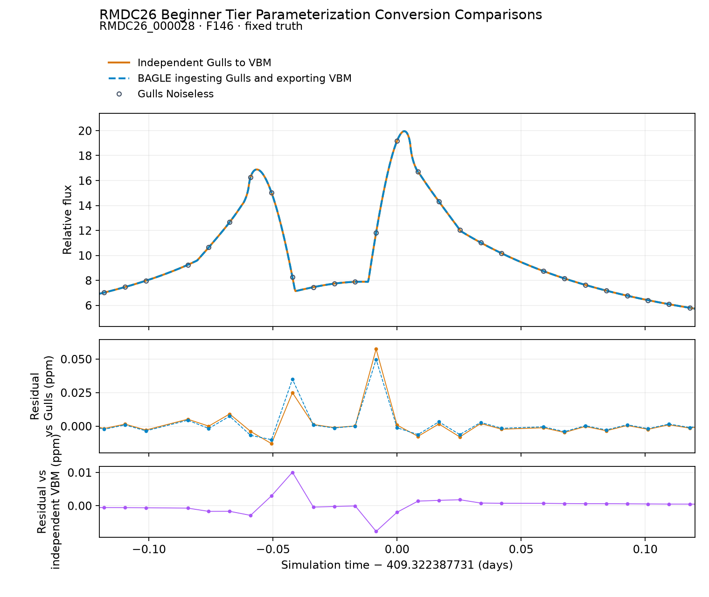
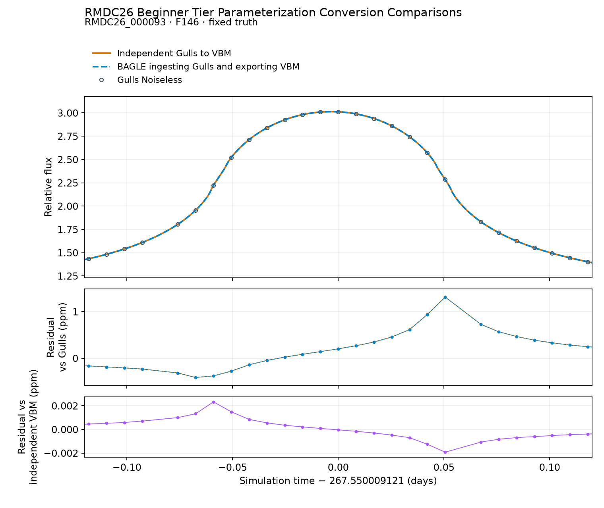

RMDC26 Beginner Gulls parameters
================================

Using the Beginner answers as a BAGLE model
-------------------------------------------

The Gulls models target BAGLE's ``fsbl_ld_jax`` development branch. They are
BAGLE model classes, built from its data, parallax, and parameterization
families following :doc:`new_models`. BAGLE calculates finite-source
magnifications, image centroids, blending, and photometry. The Gulls classes
convert the native truth and reproduce its historical Roman observer and
parallax convention.

Only the truth Parquet is needed to construct a model. The light-curve
Parquet supplies observations for comparison; it does not supply the model's
trajectory. With this checkout installed and PyArrow available, an example
is::

    import numpy as np
    import pyarrow.parquet as pq
    from bagle.gulls import load_model, JD_ZERO, JD_TO_MJD

    name = "RMDC26_000093"
    event = load_model(name, "RMDC26_Beginner_Gulls_truth.parquet")
    data = pq.read_table(
        "RMDC26_Beginner_Gulls_lightcurve_truth.parquet",
        filters=[("name", "=", name)],
    ).to_pandas()
    selected = data.observatory_code == 0  # F146
    times = data.loc[selected, "Simulation_time"].to_numpy()
    mjd = (JD_ZERO - JD_TO_MJD) + times
    magnitude = event.get_photometry(mjd, filt_idx=0)
    model_flux = 10**(-0.4 * magnitude)
    truth_flux = data.loc[selected, "true_relative_flux"].to_numpy()
    residual_ppm = (model_flux / truth_flux - 1) * 1e6

``load_model`` selects ``FSBL_Phot_Par_GullsBeginner`` for one source and
``BFSBL_Phot_Par_GullsBeginner`` for two. The default baseline magnitude is
zero in all filters, so the conversion above gives the same baseline of 1
as the saved curves. ``mag_base=...`` accepts a different scalar baseline
magnitude or three magnitudes in F146/F087/F213 order. Filter indices are
0, 1, and 2. ``event.get_amplification(mjd, filt_idx=0)`` gives magnification;
for a binary source it is weighted by the two sources' fluxes in that filter.

For a smooth plotted model, additional query times must pass through
``get_photometry``. Residuals use model evaluations at the observation times.
Each observing stretch can have its own finer grid, avoiding lines across
multi-year gaps. The model accepts MJD arrays; native ``t0lens1``, ``tcroin``,
and saved ``Simulation_time`` remain days since JD 2461406.5.

The original answer row is available as ``event.raw``. Native parameters
such as ``rho`` and ``tE_ref`` and derived BAGLE variables such as ``t0``,
``u0``, ``tE``, ``muRel_hat``, and lens positions are attributes of the model.
``event.catalog_radec`` preserves the answer-file coordinates, while
``event.event_radec`` gives the direction used for native parallax.
The class descriptions explain the lens-origin, mass, time, flux, and
parallax conversions; ``help(type(event))`` shows them in Python.

These objects use the host BAGLE model methods. Their native parameter
names do not use the development branch's JAX likelihood kernel; that
inherited kernel is disabled.

Converting through BAGLE to other packages
------------------------------------------

BAGLE's existing ``bagle.frame_convert`` functions now accept both Gulls
model classes. They convert BAGLE's derived source/lens geometry, radii,
parallax, and filter fluxes. They do not read ``raw``, saved source positions,
or observation-derived parallax shifts. The earlier direct VBM exporter
remains an independent reference for checking these conversions.

The returned destination model also carries an effective Roman observer.
It includes the historical orbit, reference position/velocity subtraction,
and parallax sign convention. An ordinary parameter dictionary alone loses
that information. This observer describes the historical photometric model;
it is not a physical geocentric satellite ephemeris.

With ``event`` and ``mjd`` from the example above, the VBM conversion is::

    from bagle import frame_convert

    vbm, parameters = frame_convert.get_vbm_model(
        event, times_mjd=mjd, filt_idx=0,
    )
    routine = (vbm.BinSourceBinLensLightCurve
               if hasattr(event, "radiusS_sec")
               else vbm.BinaryLightCurveParallax)
    result = np.asarray(routine(parameters, (mjd - 49999.5).tolist()))
    amplification = result[0]
    flux = 10**(-0.4 * event.mag_base[0]) * (
        1 + event.b_sff[0] * (amplification - 1)
    )

The VBM object contains the loaded observer table. It samples every supplied
query time, both source closest approaches, and the parallax reference.
A different query grid, including a finer plotted curve, needs another
``get_vbm_model`` call with that grid. VBM interpolates its observer table;
queries outside its span are invalid. VBM query times are JD minus 2450000,
as in the example, rather than BAGLE's MJD.

The VBM adapter uses ``Tol=1e-4, RelTol=1e-6, minannuli=1, a1=0``
and uniform brightness. For two
sources it uses VBM's combined routine with each source's radius and the
selected filter's flux ratio. That routine requires a nonzero source orbital
speed; the adapter uses a static limit with less than 5e-10 Einstein radii of
motion over the exported grid. It rejects unequal source radii at lens q=1,
which that VBM parameterization cannot encode. This restriction does not
apply to MulensModel or pyLIMA.

The MulensModel conversion keeps an analytic observer and can evaluate new
times without another conversion::

    mm = frame_convert.get_mulens_model(event, filt_idx=0)
    amplification = mm.get_magnification(mjd + JD_TO_MJD)
    flux = mm.source_fluxes.sum() * amplification + mm.blend_flux

This returns a ``MulensModel.Model`` subclass. MulensModel calculates the
trajectories and finite-source magnification; the subclass supplies the
observer through its satellite interface. It also avoids MulensModel 3.12's
shared satellite cache, whose key omits the observer ephemeris. Neither the
global cache nor MulensModel's code is patched. Both sources retain their
own radius. ``get_magnification`` uses the selected filter's source flux ratio
by default; ``separate=True`` returns the two amplifications. The default
magnification method is VBM with matching Gulls tolerances and zero limb
darkening. ``source_fluxes`` and ``blend_flux`` use BAGLE's flux convention,
10**(-0.4 * magnitude); the example combines them without MulensModel's
different magnitude zero point.

For pyLIMA::

    pl, parameters, telescope = frame_convert.get_pylima_model(
        event, times_mjd=mjd, filt_idx=0,
    )
    prediction = pl.compute_the_microlensing_model(telescope, parameters)
    flux = prediction["photometry"]
    query_jd = telescope.lightcurve["time"].value

This returns pyLIMA's stock ``USBLmodel`` (uniform-source binary lens), its
parameter dictionary, and a telescope supplying the effective observer.
The binary-source case uses pyLIMA's static double-source parameters, separate
radii, and filter flux ratio. The telescope sorts and removes duplicate
epochs; ``query_jd`` gives the order of the returned predictions. A new time
grid needs another conversion. These are supplied model fluxes; no parameters
or source/blend fluxes are fitted in these calls.

pyLIMA 1.9.8 uses a shared VBM engine with ``Tol=RelTol=1e-3`` and
``minannuli=2`` by default.
The converter leaves those package-wide settings unchanged. Consequently,
its default magnifications need not match Gulls at the smallest residuals,
even when its trajectory and parameters match. A controlled comparison with
``Tol=1e-4, RelTol=1e-6, minannuli=1`` recovered the agreement of the other
destinations;
changing pyLIMA's shared engine would affect other models in the process.

These optional routes were checked with VBMicrolensing 5.3.5, MulensModel
3.12.0, and pyLIMA 1.9.8. Each package is needed only for its own converter.
All 188 events were checked at three new epochs for matching target-computed
trajectories, including both sources. Focused flux checks covered five epochs
in each of events 028, 027, 093, and 157 in all three filters. These checks
validate parameter interoperability; they do not certify physical astrometry
or constitute a new full-catalog light-curve validation.

A small regression and example figure
------------------------------------------

``tests/test_gulls.py`` contains two fixed example regressions: event 028 has
one source, and event 093 has two. The input truth rows, expected VBM
parameters, and five reference fluxes per filter are checked in at
``examples/data/gulls_beginner_round_trip.json``. The expected values were
frozen from the independent native-truth VBM exporter. The test loads the
truth through BAGLE, checks the exported parameters, and compares model flux
against those fixed values. It requires no downloaded challenge data.

The test comments state the VBM integration controls explicitly:
``BinaryMag2, Tol=1e-4, RelTol=1e-6, minannuli=1, a1=0``. Its 0.03 ppm
comparison threshold is separate from those integration controls and allows
the measured floating-point differences in the conversion. A larger change
asks for review; the test does not fit anything or assess VBM's algorithm.
The more extensive checks used during investigation are not part of this
small regression suite.

With the two answer Parquets downloaded, ``examples/gulls_round_trip.py``
plots direct VBM from native truth, VBM after conversion through BAGLE, and
Gulls noiseless data. It includes residuals against Gulls and a separate
panel for the difference between the two VBM models. Both model lines have
a finer time grid than the observations. Every figure carries the numerical
settings in its caption. For example::

    python examples/gulls_round_trip.py truth.parquet curves.parquet \
        --event RMDC26_000093 --output comparison.html

The HTML contains Plotly and works offline. Plotly is an optional requirement
for the figure only. The same example accepts ``--event RMDC26_000028`` for
the single-source case. Neither example uses BAGLE's finite-source integrator;
it demonstrates the conversion through BAGLE into VBM parameters.

Example comparison figures
--------------------------

   This figure shows two ways of converting RMDC26 Beginner Tier Gulls parameters into a VBM light curve and compares both with the saved Gulls noiseless light curve for RMDC26_000028 in F146. Orange is “Independent Gulls to VBM”, dashed blue is “BAGLE ingesting Gulls and exporting VBM”, and open circles are “Gulls Noiseless”. The middle panel, “vs Gulls”, uses Gulls Noiseless as the reference: (model flux / Gulls Noiseless flux − 1) × 10⁶ for each model. The bottom panel uses Independent Gulls to VBM as the reference: (BAGLE-exported VBM flux / independent VBM flux − 1) × 10⁶. Both residuals are evaluated at observation times, and ppm means parts per million of the reference flux. Positive values mean the numerator model is brighter than its reference. Both model lines use a finer time grid than the observations. Both calculations use VBMicrolensing 5.3.5, BinaryMag2, Tol=1e-4, RelTol=1e-6, minannuli=1 and a1=0 (uniform brightness). Times use Simulation_time since JD 2461406.5. No parameters were fitted. BAGLE supplies the parameter conversion and VBM supplies both finite-source calculations.

   This figure shows two ways of converting RMDC26 Beginner Tier Gulls parameters into a VBM light curve and compares both with the saved Gulls noiseless light curve for RMDC26_000093 in F146. Orange is “Independent Gulls to VBM”, dashed blue is “BAGLE ingesting Gulls and exporting VBM”, and open circles are “Gulls Noiseless”. The middle panel, “vs Gulls”, uses Gulls Noiseless as the reference: (model flux / Gulls Noiseless flux − 1) × 10⁶ for each model. The bottom panel uses Independent Gulls to VBM as the reference: (BAGLE-exported VBM flux / independent VBM flux − 1) × 10⁶. Both residuals are evaluated at observation times, and ppm means parts per million of the reference flux. Positive values mean the numerator model is brighter than its reference. Both model lines use a finer time grid than the observations. Both calculations use VBMicrolensing 5.3.5, BinaryMag2, Tol=1e-4, RelTol=1e-6, minannuli=1 and a1=0 (uniform brightness). Times use Simulation_time since JD 2461406.5. No parameters were fitted. BAGLE supplies the parameter conversion and VBM supplies both finite-source calculations.

BAGLE integration accuracy and matching the original calculation
----------------------------------------------------------------

The model uses BAGLE's own source-disk contour integration. Its controls are
``event.amg_tol`` (estimated relative area tolerance),
``event.amg_max_pts`` (refinement cap), and ``n_outline`` (initial samples,
passed to ``load_model``). ``root_tol`` concerns lens-root acceptance.
BAGLE's integration can reach the sampling cap; these settings do not
certify a returned curve's accuracy. The development integrator is distinct
from the VBM calculation used to generate the archived Gulls flux.

All 188 truth rows constructed successfully in the integration check.
Photometry was spot-checked at five epochs each for events 028, 027, 093,
and 157, including their sampled peaks. At ``amg_tol=1e-6`` and a 4096-point
cap, the largest difference from VBM was about 218 ppm, at event 027's peak.
Increasing the cap to 16384 at ``amg_tol=1e-7`` did not stabilize that point.
These checks establish the parameterization and workflow, but do not
validate BAGLE's development integrator for every Beginner observation.

Related Gulls source uses ``BinaryMag2`` with ``Tol=1e-4, RelTol=1e-6``,
uniform brightness, and no lens light. Those are VBM controls, not alternate
names for BAGLE's controls. Tighter settings need not match an older numerical
calculation more closely. For comparisons at the smallest residuals,
``Simulation_time`` avoids the saved BJD's 8.64 ms rounding grid, which
produced sawtooth residuals up to 2.6 ppm in examined steep features. The
spacing of those resets depends on the observation cadence; it is not an
astrophysical period. Source radii, separations, and timescales already use
total lens mass and need no further mass conversion.

The observer follows the reconstructed Beginner ORBIT5 model and subtracts
its position and velocity at ``tcroin``. The native transverse parallax sign
differs from physical BAGLE parallax. This preserves the historical
photometric convention; standard BAGLE Earth frame conversions do not apply
to these native values. The model provides photometry and relative image
positions in Einstein radii, not certified physical sky astrometry. The exact
historical generating executable remains unidentified.

API and model construction
--------------------------

The parameter classes implement conversion in ``__init__``. Concrete models
combine ``ModelClassABC``, a Gulls specialization of BAGLE's ``FSBL_Phot`` or
``BFSBL_Phot`` data family, ``GullsBeginner_Parallax``, and the corresponding
parameter class. Their initializers run ``startbases`` and ``checkconflicts``.
The data specializations dispatch the historical trajectory; all source
integration, image magnification, and photometry methods remain inherited
from BAGLE. The analytic observer lives in ``gulls_orbit.py`` and has no
magnification-engine dependency.

.. autofunction:: bagle.gulls.load_model

.. autoclass:: bagle.gulls_model.FSBL_PhotParamGullsBeginner

.. autoclass:: bagle.gulls_model.BFSBL_PhotParamGullsBeginner

.. autoclass:: bagle.gulls_model.FSBL_Phot_Par_GullsBeginner

.. autoclass:: bagle.gulls_model.BFSBL_Phot_Par_GullsBeginner

The interfaces below preserve earlier comparison work. ``GullsBeginner`` is
the original truth adapter; ``load_model`` is the entry point for the new
BAGLE model classes. ``predict`` and the VBM bundle exporter remain separate
VBM conveniences and do not stand in for BAGLE inheritance.

Earlier VBM convenience interface
---------------------------------

``GullsBeginner.predict`` generates a VBM model from the two Beginner answer
Parquets. It handles the observer orbit, coordinate conversion, source radii,
and band fluxes internally, for both single-source and binary-source events.
The original parameters remain available as ``event.raw``.

The ``gulls`` optional dependency group installs PyArrow and VBMicrolensing
5.3.5 alongside BAGLE. With the two files downloaded, a comparison needs::

    from bagle.gulls import load_event

    event = load_event(
        "RMDC26_000093",
        "RMDC26_Beginner_Gulls_truth.parquet",
        "RMDC26_Beginner_Gulls_lightcurve_truth.parquet",
    )
    data = event.curve.to_pandas()
    model_flux = event.predict()
    residual_ppm = (model_flux / data.true_relative_flux - 1) * 1e6

``model_flux`` has one value per observation, in the original row order.
The total unlensed baseline is 1. ``true_relative_flux`` is noiseless;
``measured_relative_flux`` includes noise, and
``measured_relative_flux_error`` gives its uncertainty in the same units.

A smooth model line requires evaluating additional times, rather than
connecting or interpolating the observations. For example::

    import numpy as np

    times = np.linspace(267.0, 268.0, 4001)
    smooth_flux = event.predict(times, band="F146")

For a whole-event plot, subdividing each observation interval keeps the model
grid finer than the data. A fixed number of evenly spaced points over several
years can miss sharp features. Separate observing stretches avoid drawing a
line through gaps. Residuals use the model at the observation times, not an
interpolation of the plotted line.

These are simulation days since JD 2461406.5. The band names are F146, F087,
and F213 (codes 0, 1, and 2); the older names W146, Z087, and K213 are accepted
as aliases. ``predict()`` uses each observation's ``Simulation_time`` and band
automatically. Explicit times require an explicit band.

The default magnification tolerances are ``Tol=1e-4, RelTol=1e-6``, matching
related Gulls source. They are exposed as ``accuracy`` and
``relative_accuracy``. The method uses the reconstructed Beginner ORBIT5
observer and produces photometry; it does not claim physical astrometric
equivalence. Small remaining differences from the archived flux are expected.
``help(event.predict)`` contains the input conventions and examples.

``Simulation_time`` retains more precision than printed BJD. The 8.64 ms BJD
rounding grid produced residuals up to 2.6 ppm in examined events, amplified
where the light curve changes rapidly. ``predict`` avoids that mismatch by
using simulation times and reduced-JD arithmetic internally.

Other parameter and rendering interfaces
----------------------------------------

``bagle.gulls`` loads an existing Beginner truth row and its native light curve
by challenge event name. It renders the saved epochs with finite-source binary
lens magnifications without fitting the injected parameters or fluxes. Parquet
loading requires the optional ``pyarrow`` package; rendering requires
``VBMicrolensing``.

Load the two published-format Parquets directly. The curve columns below
include the recorded observer shifts and both source positions::

    from bagle.gulls import load_event

    event = load_event(
        'RMDC26_000002', 'RMDC26_Beginner_Gulls_truth.parquet',
        'RMDC26_Beginner_Gulls_lightcurve_truth.parquet',
        columns=[
            'BJD', 'parallax_shift_t', 'parallax_shift_u',
            'observatory_code', 'source_x', 'source_y',
            'source2_x', 'source2_y',
        ],
    )
    catalog_ra, catalog_dec = event.catalog_radec
    event_ra, event_dec = event.event_radec
    source_magnifications, combined_magnification, relative_flux = \
        event.render_native_sources()

``event.catalog_radec`` returns the answer-file ``ra_deg`` and ``dec_deg``
values in degrees. ``event.event_radec`` returns the effective event
direction used by the high-level VBM export, also in degrees. The original
answer-file values remain available in ``event.raw`` and are not overwritten.
Here, “catalog” names the input pair saved in the Beginner answer file. It does
not refer to ``Source_RA20000`` or ``Source_DEC20000``, which are separate
stellar-source fields when present. You can convert another input pair with
``catalog_to_event_radec``::

    from bagle.gulls import catalog_to_event_radec

    event_ra, event_dec = catalog_to_event_radec(catalog_ra, catalog_dec)

When the truth row has both ``galactic_l`` and ``galactic_b``, BAGLE derives
``event_radec`` directly from those saved values. Otherwise, it reverses the
rounded matrix used to save the answer-file RA/Dec with a linear solve, then
applies the matrix used by Gulls' parallax path. This reproduces the two
coordinate paths used for these events. This describes Gulls' effective event
direction; it does not establish a general reference-frame transformation or
claim that one matrix is more physically accurate. Use a standard astrometry
library for general coordinate transformations. RA wraps to ``[0, 360)``
degrees, and Dec must be within ``[-90, 90]`` degrees.

``source_magnifications`` has one row per source and one column per saved
epoch. ``combined_magnification`` weights the two source magnifications by
their baseline fluxes in the epoch's observatory band. ``relative_flux`` is
the predicted total flux relative to the native baseline. For the 71
single-source events, ``event.render_native()`` keeps its original return
values: raw source magnification and relative flux.

The truth file contains 71 single-source and 117 binary-source events. The
binary-source renderer calls ``VBMicrolensing.BinaryMag2`` once per source and
epoch, using ``rho`` for source 1 and ``Source2_rho`` for source 2. It supports
the saved uniform-source profile (``LDgamma == 0``). It applies the fixed
baseline flux fractions from truth as

.. math::

   F = 1 + f_1(A_1 - 1) + f_2(A_2 - 1),

where ``Obs_i_fs`` is :math:`f_1` and ``Obs_i_fs2ofs1`` is already the
secondary source's total-baseline fraction :math:`f_2`. The latter equals the
primary source fraction multiplied by the intrinsic secondary-to-primary
flux ratio. It must not be multiplied by ``Obs_i_fs`` again. The renderer
does not fit either source's flux.

For binary-source events, the primary position is computed from truth and the
recorded observer shifts. The class adds the saved per-epoch secondary-minus-
primary offset from the curve. This retains epoch-dependent changes while
reducing the effect of rounded absolute coordinates in the curve. The two
source radii and the three band-specific secondary flux fractions are
validated separately. The observer shifts and source offsets are used only at
the saved native epochs; the class does not extrapolate an observer or source
orbit to arbitrary times.

``to_bagle`` returns keyword arguments for BAGLE's
``PSBL_Phot_noPar_Param1`` single-source, point-source model. It remains
available for the original single-source profile and raises
``UnsupportedGullsEvent`` for binary-source events so that the secondary
source cannot be silently omitted. ``to_mulensmodel`` likewise returns only a
single-source parameter set. For native finite-source predictions, use
``render_native_sources`` or ``render_native``.

The BAGLE dictionary uses the geometric lens midpoint and MJD notation; the
MulensModel dictionary uses the lens center of mass and absolute native BJD.
Saved ``rho``, ``s``, ``thetaE`` and timescales already use total lens mass.
The original lens-1 trajectory is retained, without recomputing the CROIN
draw. The parallax reference is ``tcroin``, distinct from closest approach.
The native BJD time scale has not been independently established; subtracting
2400000.5 only changes the notation.

The saved observer shifts come from the Beginner native curves. They do not
define an observer at arbitrary times, and BAGLE's standard Earth parallax is
not a substitute for the simulated Roman ORBIT 5 L2 observer. The General
astrometry comparison supports rotating the injected ecliptic lens-minus-source
parallax into equatorial coordinates. ``physical_parallax`` returns that
vector and its source-minus-lens negative. General's geoproj PSPL input uses
the former; the PSBL class used by ``to_bagle`` uses the latter. Its impact
parameter sign is determined from its sky-vector convention, and is not the
same scalar convention as General's geoproj class.

The saved trajectory uses the historical transverse-parallax sign, whereas
General's astrometry correction uses the opposite sign. ``parallax_shifts``
requires an explicit ``native`` or ``physical`` convention and reference-
subtracted observer EN displacement in AU. The reference is the simulated
observer's position and velocity at ``tcroin``. For a lens-minus-source
ecliptic vector (pE, pN) and displacement (E, N), native gives
(-pE*E-pN*N, pE*N-pN*E); physical negates the second component. The native
renderer continues to use the recorded shifts without reinterpreting them.
The two conventions therefore do not describe identical perturbed light
curves, and a standard Earth-observer BAGLE model is not an exact native
prediction. A reflection about the injected parallax direction can arise when
an observer is reconstructed from recorded shifts with the opposite sign; it
is not a general conversion for the actual observer.

The Beginner centroid columns are zero placeholders. The historical sign is
supported by saved observer positions and a related old source branch, but the
exact generating binary revision has not been authenticated. The historical
stale previous-event crossing-time issue may have affected the draw; the saved
current trajectory is preserved.

High-level VBMicrolensing model
-------------------------------

For a single-source event, ``to_vbm`` writes a parameter bundle that lets
VBMicrolensing 5.3.5 calculate the trajectory and finite-source binary-lens
magnification itself. It does not read the saved trajectory or parallax
shifts. For example, after loading the event and its epochs::

    import numpy as np
    from bagle.gulls import JD_ZERO, load_event
    from bagle.gulls_vbm import roman_orbit5

    event = load_event('RMDC26_000028', truth_path, curve_path,
                       columns=['BJD', 'observatory_code'])
    times = np.asarray(event.curve['BJD'].to_numpy())
    row = event.raw
    alpha = np.deg2rad(row['alpha'])
    center = row['Planet_s'] * row['Planet_q'] / (1 + row['Planet_q'])
    t0 = JD_ZERO + row['t0lens1'] + center * row['tE_ref'] * np.cos(alpha)
    grid_values = np.unique(np.r_[times, t0])
    grid = np.r_[grid_values[0] - 0.01, grid_values, grid_values[-1] + 0.01]
    xyz, ref_xyz, ref_velocity = roman_orbit5(grid, event.reference_bjd)
    event.to_vbm('vbm_bundle', grid, xyz, ref_xyz, ref_velocity)

The observer grid must include the primary source reference time as well as
the prediction epochs. VBM uses that reference to calculate its parallax
trajectory.

For prediction, export the epochs as a CSV with ``BJD`` and
``observatory_code`` columns and run::

    python examples/gulls_vbm_only.py vbm_bundle epochs.csv > predictions.csv

This prediction script imports VBM and NumPy, but not BAGLE or MulensModel.
The output has the source magnification, relative flux and VBM-computed source
coordinates. For binary-source bundles it includes both source coordinates.
The export keeps truth unchanged and uses the fixed truth source fractions for
relative flux.

The VBM parameter array is ``[ln(s), ln(q), u0, alpha, ln(rho), ln(tE),
t0, piE_N, piE_E]``. Angles are radians, times are days, and VBM's time
values are the native BJD values minus 2450000. If :math:`c=sq/(1+q)`,
the exported COM values are :math:`u_0=u_{0,1}+c\sin\alpha_G`,
:math:`t_0=t_{0,1}+ct_E\cos\alpha_G`, and
:math:`\alpha=\alpha_G+\pi`. The saved total-mass values of ``s``, ``q``,
``rho`` and ``tE`` are not rescaled. The parallax components are the saved
ecliptic lens-minus-source vector rotated into equatorial north/east. VBM's
south/west observer projections give the historical native signs in both
trajectory coordinates. This is a convention conversion, not a correction to
the physical astrometry.

The high-level VBM export writes ``event.event_radec`` to ``coordinates.txt``
and uses the same direction to rotate the ecliptic parallax vector. That
rotation uses the native Gulls ecliptic obliquity, 23.439279444444445 degrees.
The bundle's ``coordinates`` metadata records both ``catalog_radec_deg`` and
``event_radec_deg``, the fields used to choose the event direction, and the
obliquity. ``physical_parallax``, ``to_bagle`` and ``to_mulensmodel`` retain
their existing input-coordinate and physical-parallax conventions. The
recorded-epoch ``native_trajectory`` and ``render_native`` paths also remain
unchanged.

VBM 5.3.5's ``BinaryLightCurveParallax`` uses ``t0_par`` in the linear
trajectory when it is fixed, rather than the separate ``t0`` array entry.
The bundle sets both to the COM closest-approach time. Its satellite file holds
the observer's ecliptic position relative to its position and linear velocity
at the original ``tcroin``, converted to the equatorial format VBM reads.
A stationary zero-distance Sun table supplies the origin, and ``t_in_HJD`` is
false so VBM adds no light-travel term. These tables describe the reference
frame and observer, not precomputed source positions. They should not be
interpreted as a physical Sun or satellite ephemeris. The source direction,
observer reference position and velocity, and actual observer path are all
needed to make this conversion. The original truth still retains its distinct
``tcroin`` and lens-1 closest-approach time.

``roman_orbit5`` implements the Earth-L2 and JWST-like orbital elements in a
related Gulls source. The exact Beginner executable revision is unknown. A
fixed-parameter validation used all 3,485,816 saved epochs from the 71
single-source events. With ``Tol=1e-4`` and ``RelTol=1e-10``, the largest flux
difference was 0.000911895 times the saved measurement uncertainty, in event
028. The largest track difference from the saved-shift calculation was
7.16e-6 Einstein radii, in event 099. No predictions were invalid and VBM did
not extrapolate its observer table. These numerical comparisons do not claim
bitwise equivalence. VBM interpolates the satellite table linearly; for other
epochs, supply a sufficiently dense grid spanning those epochs.
The ``observer_xyz``, ``reference_xyz`` and ``reference_velocity`` arguments
also accept an independently supplied observer in the documented ecliptic
frame. The physical time scale of native BJD has not been independently
established; the VBM settings here are selected to reproduce its numeric
values without adding a time correction.

Binary-source high-level VBM model
----------------------------------

For a binary-source event, ``to_vbm`` writes a bundle for VBM's stock
``BinSourceBinLensLightCurve`` routine. VBM calculates both source tracks and
their finite-source binary-lens magnification from the parameters in the
bundle. The export does not read the saved source-coordinate columns. It
stores the projected source separation calculated from ``Source2_s``,
``Source2_alpha``, ``Source2_inc`` and ``Source2_phase`` in truth.

The second source's projected offset in the lens-axis coordinates is

.. math::

   d_x = s_2(\cos\phi\cos\Omega - \sin\phi\cos i\sin\Omega),\quad
   d_y = s_2(\cos\phi\sin\Omega + \sin\phi\cos i\cos\Omega),

where :math:`s_2`, :math:`\Omega`, :math:`i` and :math:`\phi` are the four
saved truth fields above. The export converts this offset into the second
source's closest-approach time and impact parameter. Both source tracks then
share the same observer and parallax reference.

VBM's combined routine accepts one source flux ratio and ties the second
radius to its mass and luminosity exponents. Beginner truth has independent
source radii and three band-specific flux ratios. The export therefore calls
the same high-level routine once per band. It sets the exposed VBM exponents
from the truth mass ratio and the saved radius and flux ratios. When both the
mass ratio and band flux ratio differ from unity, the luminosity exponent
recovers the truth mass ratio exactly. If either ratio is unity, no finite
exponent can recover both ratios; the export uses a finite value because its
source-orbit speed is negligible. These exponents can be nonphysical; they
translate the independent truth values into VBM's parameterization without
fitting.
VBM 5.3.5 cannot encode unequal source radii at exactly unit lens mass ratio,
so export reports that case as unsupported. The predicted source magnification
is then converted to total relative flux using the fixed total-baseline source
fractions.

VBM 5.3.5 requires a nonzero third relative source-velocity component while it
constructs its circular orbit. The saved Beginner light curves are reproduced
by the static projected separation. The export represents that static limit
with a small third-component velocity that bounds the source-motion excursion
below ``5e-10`` Einstein radii across the supplied observer grid. VBM still
computes both trajectories from its high-level parameters; the bundle contains
no per-epoch source positions.
The exact historical Beginner generator revision is not authenticated. The
saved source positions are rounded, and can differ from the reconstructed
component tracks by up to ``0.00732`` Einstein radii. The fixed-parameter
light-curve comparison is the relevant validation for this export.

The VBM-only prediction script accepts both single-source and binary-source
bundles. For a binary-source bundle, it returns the combined source
magnification, relative flux, and both VBM-computed source coordinates. It
imports VBM and NumPy, but not BAGLE or MulensModel.

The earlier binary-source comparison reported a largest residual of ``0.01673``
measurement sigma because its VBM export used the answer-file RA/Dec directly.
The corrected export uses the effective event direction and the native Gulls
ecliptic obliquity. A fixed-parameter rerun covered all 117 binary-source
events and 5,744,232 epochs at ``Tol=1e-4`` and ``RelTol=1e-10``. It produced no
invalid predictions or observer extrapolations. The largest flux residual was
``0.000919987`` measurement sigma, in event 157. The largest difference for
either source track from the truth-based track and projected source separation
was ``7.19e-6`` Einstein radii, in event 145. The comparison used no fitting.
The old ``0.01673`` residual is retained here as the earlier result so readers
can see why the coordinate update changed the reported value.

For RMDC26_000093, a separate check used the 33 W146 epochs within 0.15 day of
BJD 2461674.1006. At ``Tol=1e-4`` and ``RelTol=1e-6``, the residual at the
anchor epoch was ``+0.000257136`` measurement sigma; the window maximum was
``0.000617604`` and its RMS was ``0.000164916``. At ``Tol=1e-10`` and
``RelTol=1e-12``, the anchor residual was ``+0.000438217``, the window maximum
was ``0.000864899``, and its RMS was ``0.000354861``. Both checks used fixed
truth parameters and the same observer path. The validation driver and
per-event results are in the private review evidence under
``reviews/catalog_event_coordinates``.
